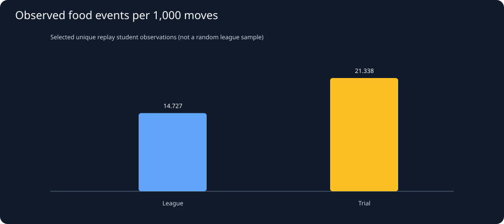
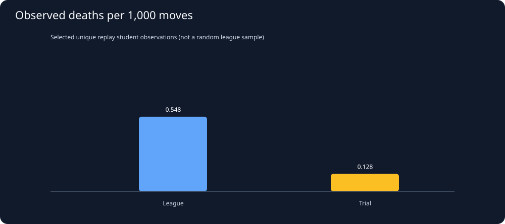

# Snake26: Replay behavior by environment, then joined by student

Generated UTC: 2026-11-02T06:51:58+00:00

**Source:** full replay-derived behavior table, NOT catalog outcome proxies.
Every student/match is grouped by explicit match kind. A SHA-identical
replay reused in another season is counted once per student here.
Student-only versus mixed league game composition is retained by
excluding one-student matches. Full opponent strength is not controlled.

## 1. How many students have observations in BOTH environments?

- Current official season: **2026-11-02-045859-season**.
- Current season unique students with at least one replay in EACH mode: **0**.
- Duplicate student/replay SHA observations excluded: **24**.
- One-student league observations excluded: **0**.
- Student-replay exposures from league: **181**.
- Student-replay exposures from trials: **54**.

## 2. Two different game environments

These rates use confirmed replay observation counts and measured moves
as exposure. They are NOT apples/deaths per game, nor lifetime survival probabilities.
They combine different opponents and selected matches: do not interpret
the group gap as a treatment or optimal aggression setting.

## 3. Join the SAME student-season across both replay sources

| Replay-derived metric | Students with BOTH modes | Spearman rho league vs trial |
|---|---:|---:|
| Food events per 1,000 observed moves | 0 | insufficient |
| Death events per 1,000 observed moves | 0 | insufficient |
| Straight-move fraction | 0 | insufficient |

If too few students have replay evidence on both sides, correlation is
reported as insufficient—not extrapolated from catalog placements.

## 4. Export and next controls

- [One row per observed student/season/mode](../derived/replay_behavior_by_mode.csv).
- [Main catalog-based joined study](joint_analysis.md).
- Need matched opponent strength, turn/length stratification and more
  Division 1 student-versus-student replays for mechanism claims.
- Multiple moves within one match are correlated; do not use naive turn-level
  confidence intervals or mistake sample selection for a fair experiment.
- Bot SHA tracked at season snapshot only; mid-season changes may exist.
