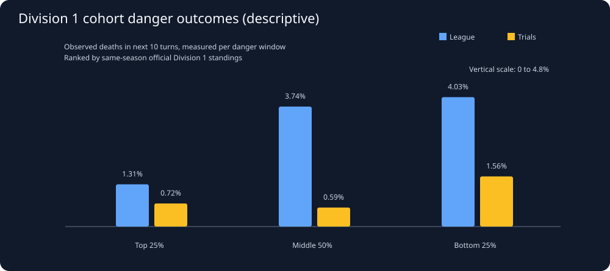

# Snake26: Strong, middle, and struggling league competitors — comparison

Generated UTC: 2026-11-03T12:30:04+00:00

## Scientific question

Across the competition, what danger-response patterns distinguish
consistently strong versus weaker *official league* snakes in
comparable situations? This is a population-level exploration,
NOT a study of our submitted agent or a named rival. ALL student bots
are eligible. Palmer is one top-division example, not the baseline.

## Cohort design and selection caveats

- Use official Division 1 standings from the **SAME replay season**
  as each sampled student, never transplant today's rank into older
  bot versions. Division 2 ranks are not mixed into Division 1.
- Top cohort: official division rank in best 25%; bottom: worst 25%;
  middle: remaining 50%. Only standings with at least 12 members qualify.
- A frame is sampled every 25 turns only when a student is near
  another live head (within 3 toroidal cells) OR has <=1 unoccupied
  neighbor. Same raw replay payload counted once, not once per season.
- Outcomes: real death event in the following 10 or 30 turns,
  with incomplete followup CENSORED and respawn still a death.
- We focus on actual league matches; controlled trials are shown
  SEPARATELY, grouped by the student's same-season league standing.
- Historical archived replays are deliberately sampled, not a random
  draw from all official matches. Rankings include game results;
  ranking groups are outcome-selected, not randomized policies.

Baseline windows available across BOTH environments: **3,778**.
Same-season Division 1 ranked league windows: **2,385**.
Same-season Division 1 ranked trial windows: **316**.
League windows without qualifying same-season rank: **763**.
Trial windows without qualifying same-season rank: **314**.
Duplicate rows excluded: **0**.

## 1. Observed danger exposure and outcomes by performance cohort

| Match mode | Division 1 cohort | Students | Unique replays | Danger windows | Nearby heads | Confinement | Death by +10 (events/windows) | Death by +30 (events/windows) | Gained exit by +3 (among +10 survivors) | First move straight | Moved toward a persistent apple |
|---|---|---:|---:|---:|---|---|---|---|---|---|---|
| league | top_quartile | 15 | 56 | 745 | 65.23% | 41.74% | 11/745 (1.48%) | 17/733 (2.32%) | 734 sampled, 40.19% | 745 moves, 55.17% | 705 moves, 55.18% |
| league | middle_half | 37 | 60 | 1174 | 62.78% | 42.25% | 44/1174 (3.75%) | 73/1158 (6.30%) | 1130 sampled, 38.58% | 1169 moves, 57.23% | 1112 moves, 56.03% |
| league | bottom_quartile | 24 | 41 | 466 | 66.09% | 38.41% | 18/466 (3.86%) | 27/461 (5.86%) | 448 sampled, 35.71% | 465 moves, 63.66% | 438 moves, 54.34% |
| trial | top_quartile | 10 | 17 | 128 | 75.00% | 29.69% | 1/128 (0.78%) | 2/127 (1.57%) | 127 sampled, 29.92% | 128 moves, 67.19% | 119 moves, 67.23% |
| trial | middle_half | 10 | 14 | 143 | 65.73% | 43.36% | 0/143 (0.00%) | 0/142 (0.00%) | 143 sampled, 40.56% | 143 moves, 67.13% | 131 moves, 55.73% |
| trial | bottom_quartile | 5 | 5 | 45 | 84.44% | 20.00% | 0/45 (0.00%) | 0/45 (0.00%) | 45 sampled, 28.89% | 45 moves, 62.22% | 40 moves, 67.50% |

First-move straight/turn is reconstructed from two consecutive REAL frames.
Food progress means closing distance to the SAME apple still visible
one frame later; this does not prove the snake targeted that apple.
These rows DESCRIBE the encounters each cohort experienced; they do
not establish that stronger snakes made different decisions inequivalent states. A difference may reflect opponents and selection.

## 2. Restrict to comparable pre-decision danger situations

Common-support strata require BOTH top and bottom students in the
SAME environment, body length band, near-head yes/no, restricted
neighbor count yes/no, and 500-turn phase. Each group must contain
actual observations; we do not extrapolate outside overlap.

- Common strata across both modes: **49**.
- League replays with ranked student exposures: **65**.
- Those containing BOTH extreme cohorts: **36**.
- Distinct top/bottom students in overlapping games: **35**.

| Mode | Cohort within overlap | Windows | Distinct replays | +10 death frequency | +3 exit gain frequency | First-move straight | Same-apple progress |
|---|---|---:|---:|---|---|---|---|
| league | top_quartile | 744 | 56 | 1.48% | 40.25% | 55.11% | 55.26% |
| league | bottom_quartile | 459 | 41 | 3.70% | 35.52% | 63.97% | 54.06% |
| trial | top_quartile | 120 | 17 | 0.83% | 28.57% | 69.17% | 67.57% |
| trial | bottom_quartile | 37 | 5 | 0.00% | 24.32% | 62.16% | 61.76% |

## 3. Strong versus struggling snakes in the SAME real match

Each pair uses one top-quartile and one bottom-quartile student
from the SAME actual replay, SAME body-length band, near-head
condition, confined/unconfined condition, and 500-turn game phase.
Pairing uses only BASELINE variables, and no observed window is reused.
This is a harder comparison than grouping results across unrelated
games, but pairs may still differ in exact body location, apples,
opponent responses and how much time passes between snapshots.

Matched dangerous-position pairs: **88**.
Distinct league replays with strict matched pairs: **27**.

| Measured outcome (bottom minus top) | Both decisions observable | Replay clusters | Difference (percentage points) | Replay-resampled 95% interval |
|---|---:|---:|---:|---|
| Died in next 10 turns | 88 | 27 | +4.55 | [+1.02, +9.21] |
| First step was a turn/reversal rather than straight | 88 | 27 | -9.09 | [-23.38, +2.59] |
| Moved toward same still-visible apple | 82 | 27 | -4.88 | [-20.78, +11.36] |
| Gained 1+ neighboring cell by turn 3, among +10 survivors | 82 | 26 | -7.32 | [-18.64, +2.38] |

Positive values mean the bottom cohort exhibited the behavior or
death more frequently; negative values mean the top did.
Match-level bootstrap uncertainty addresses repeated episodes in
one replay, NOT repeated student versions across snapshots.
Even equal baseline categories are NOT identical legal choices;
none of these contrasts alone tells us which action caused survival.
[Auditable non-reused matched pairs](../derived/competitive_matched_decisions.csv).

These are COMMON-STRATUM comparisons but they are NOT reweighted
to identical distributions within the overlap. Even same-game cohorts
may occupy different locations and face unequal threats. No p-value
or effect-size certainty is claimed from individual windows.

## 4. What would make a useful algorithm rule?

Test the hypothesis that top league competitors select routes with
better safe future mobility after controlling for starting length,
head geometry and food opportunity. Our 0–4 free-neighbor count is
an INSTANTANEOUS proxy, not a legal-move count or full route quality.
We must next measure per-ACTION future reachable areas and opponent
reach cones, then reproduce any predictive advantage on HELD-OUT
entire matches and unseen bot versions.
A cohort difference at this stage is evidence for a feature to
test, NEVER evidence that copying a champion's move is optimal.

## Auditable outputs

- [Cohort sample sizes, outcomes, mobility](../derived/competitive_cohort_danger.csv).
- [Underlying complete danger-window observations](../derived/long_horizon_danger_windows.csv).
- [Research protocol and rule-promotion tests](../../docs/ALGORITHM_RESEARCH_PROTOCOL.md).

**No existing submitted snake code was modified.**
