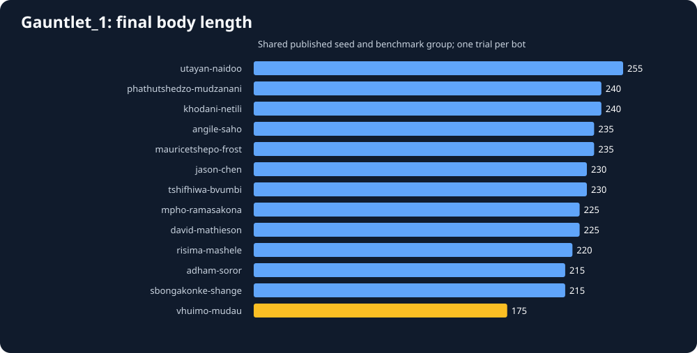
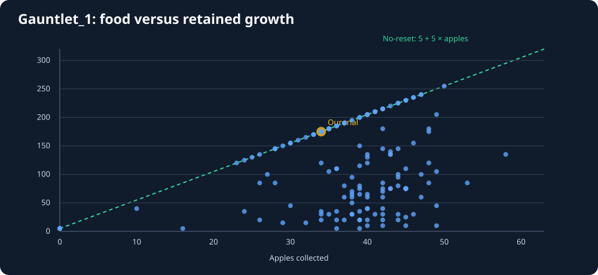
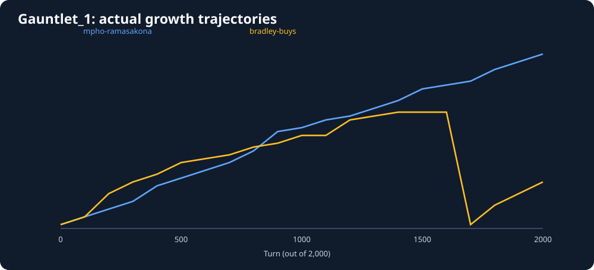
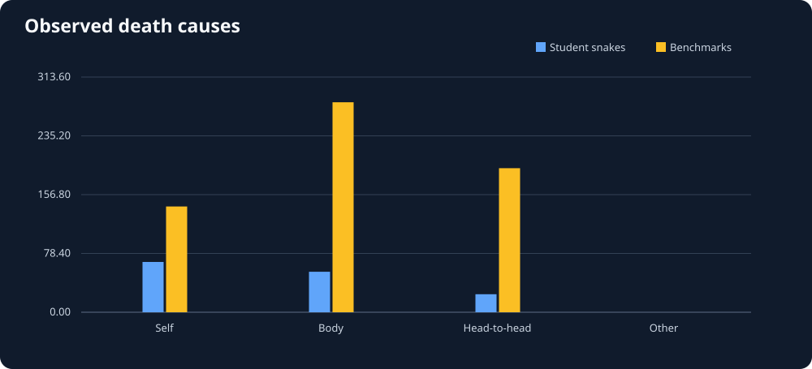
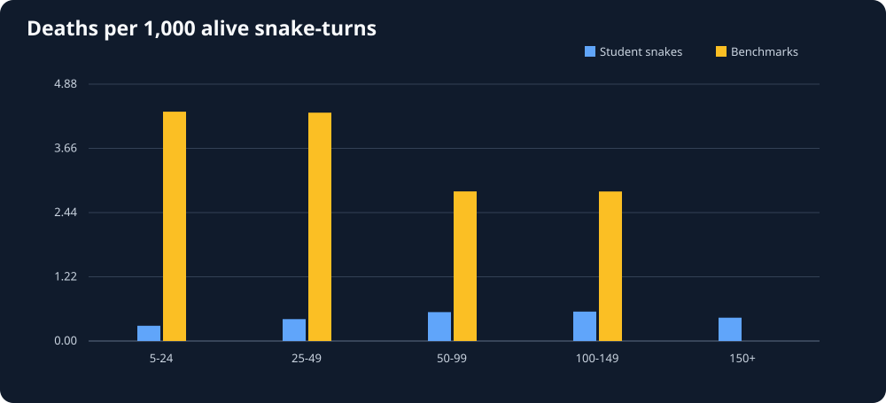
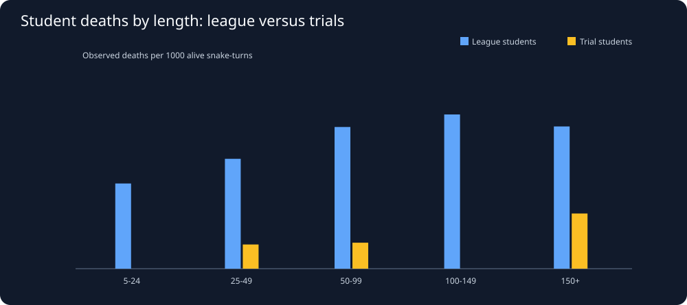

# Snake26 — Data Science Dashboard: Phase I

Generated UTC: 2026-11-02T00:42:56+00:00

## Data coverage and quality

- Cataloged seasons: **55**; match records: **24,480**.
- Replay records marked downloaded in SQLite: **160**.
- Files on disk: **160**; sampled: **160**.
- Unique replay payloads (SHA-256): **96**; duplicate payloads skipped: **64**; unreadable: **0**.
- Latest season: **2026-11-01-235859-season**; published gauntlet_1 trial results: **146**.

> Thousands of catalog records are not thousands of independent replay observations.
> Adjacent turns are correlated. Same bot, version, opponent setup or seed can recur.
> These plots describe outcomes; they do not prove why any bot wins.

## 1. Comparable gauntlet_1 trial outcomes

A single shared-seed on-arrival match per student is not evidence of consistent performance.
Our recorded trial: **175 final length**, **34 apples**, placement **1**.

## 2. Food acquired versus retained growth

The no-reset relation **L = 5 + 5 × apples** holds exactly in **53/146** reported trials.
**0** result(s) exceed this reference: inspect game mechanics if nonzero.
Below-reference points may reflect growth lost to deaths, but only full replay events establish their cause.

## 3. Observed growth trajectories

Current-season gauntlet_1 trial replays with trajectories: **1**.
Actual recorded body lengths, sampled every 100 turns; missing curves are not interpolated.

## 4. Deaths by recorded cause (all match modes pooled)

Raw counts mix opponent groups and survival exposure; they are not comparable risk rates.

## 5. Death-event rate by body length (all match modes pooled)

| Length range | Student alive turns | Student deaths | Deaths / 1,000 alive turns | Benchmark alive turns | Benchmark deaths |
|---|---:|---:|---:|---:|---:|
| 5-24 | 95,799 | 33 | 0.344 | 181,440 | 782 |
| 25-49 | 97,511 | 44 | 0.451 | 61,347 | 268 |
| 50-99 | 153,385 | 83 | 0.541 | 25,882 | 82 |
| 100-149 | 94,013 | 48 | 0.511 | 1,343 | 4 |
| 150+ | 48,121 | 17 | 0.353 | 0 | 0 |

Exposure: one alive snake at the start of an observed turn. A death is attributed
to its previous alive state, not the dead/respawned frame's length. A zero-exposure
bin is **unknown**, not safe. Rates are descriptive and not independent probabilities.
These pooled figures DO NOT establish differences between the two game environments.

## 6. Corrected: student death risk separated by mode

| Length | League alive turns | League deaths | League rate / 1000 | Trial alive turns | Trial deaths | Trial rate / 1000 |
|---|---:|---:|---:|---:|---:|---:|
| 5-24 | 87,573 | 33 | 0.377 | 8,226 | 0 | 0.000 |
| 25-49 | 87,040 | 43 | 0.494 | 10,471 | 1 | 0.096 |
| 50-99 | 134,022 | 81 | 0.604 | 19,363 | 2 | 0.103 |
| 100-149 | 72,500 | 48 | 0.662 | 21,513 | 0 | 0.000 |
| 150+ | 15,749 | 9 | 0.571 | 32,372 | 8 | 0.247 |

Unique full replay payloads sampled: league 50, trials 46.
A missing bar denotes NO exposure, not zero risk. Different opponents,
seeds and bot versions make these observational, non-causal comparisons.

## 7. Research roadmap — no competition-snake changes yet

1. Detailed pre-death event studies and matched successful escapes.
2. Food-contest timelines: distance to food at spawn, arrival times, and head pressure.
3. Territory and opponent danger, including tail vacancy and time-dependent occupied space.
4. Code-version cohorts and match-level/bootstrap uncertainty intervals.
5. Separate league battles from fixed on-arrival trials before any causal claims.

We cannot replay private competitors as live executables using fixed recorded moves.
