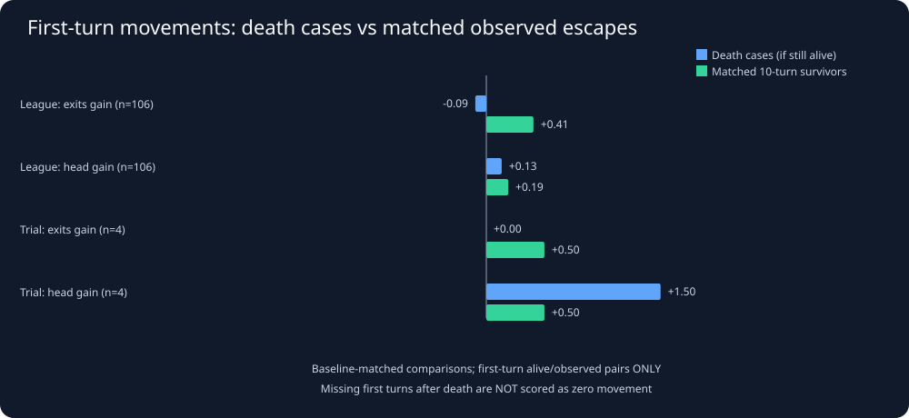
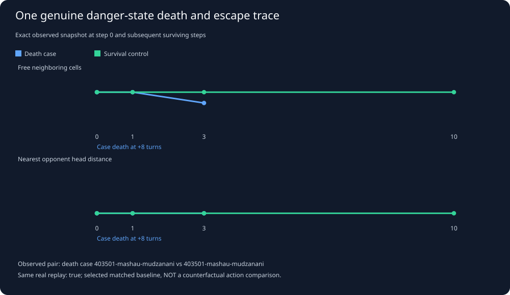

# Snake26: Death autopsies versus successful real escapes

Generated UTC: 2026-11-03T04:10:30+00:00

## Research question

Among student snakes starting in *similarly dangerous real positions*,
what did snakes that survived the NEXT ten turns visibly do, compared
with snakes that actually died? This is a RETROSPECTIVE case–control
observation, not a randomized experiment or a policy recommendation.

## Methods and data quality

1. Sample each living student every 25 turns in unique full replay files.
   Include positions with an opponent head within three toroidal cells,
   or zero/one currently unoccupied neighboring cells.
2. Require ten contiguous future frames. A 'death' case must have
   a genuine **died** event in turns +1 to +10. A control has no died
   event in those ten turns. Mere 'survived at turn 2,000' is insufficient.
3. Match cases to controls **within the SAME match mode**, body-length
   band, baseline head-pressure band, and limited-exits band. Also match
   500-turn game phase where available; if not, the phase is relaxed
   and disclosed. Prefer an actual control from the SAME replay.
4. Compare actual free-neighbor changes, head-distance changes and
   pursuit of the SAME still-visible apple after turns +1 and +3.
   If a snake dies before an observation, that step is **missing**—
   NEVER zero, and NEVER a hypothetical move.
5. Separately resample full case-replay clusters for exploratory CIs.
   Multiple cases from the same game remain dependent; cross-replay
   control matching creates further dependency.

Files scanned: **210** of 210.
Unique replay payloads: **141**
(league 75, trial 66).
Duplicate replays skipped: **69**.
Unreadable: **0**.
Valid dangerous baseline positions: **3,301**.

## 1. Baseline-matched death cases and observed survivor controls

| Match mode | Death cases | Survivor control candidates | Matched pairs | Same replay | Phase relaxed | Unmatched deaths |
|---|---:|---:|---:|---:|---:|---:|
| league | 85 | 2660 | 85 | 45 | 2 | 0 |
| trial | 4 | 552 | 3 | 0 | 1 | 1 |

Matching minimizes observable baseline differences. It does NOT balance
unobserved bot policy, opponent skill, map future, or specific matchup.
Some controls come from other real games; report same-match counts.

## 2. First observed escape movements (post-baseline)

| Mode | Step | Real measured change | Alive and measured matched pairs | Death cases mean | Survivor controls mean | Survivor − case | Exploratory match-bootstrap interval |
|---|---:|---|---:|---:|---:|---:|---|
| league | +1 | exits_gain | 77 | -0.09 | +0.45 | +0.55 | [+0.36, +0.76], 48 case-replay clusters |
| league | +1 | head_gain | 77 | +0.12 | +0.27 | +0.16 | [-0.15, +0.49], 48 case-replay clusters |
| league | +1 | stable_food_progress | 67 | +0.07 | +0.12 | +0.04 | [-0.28, +0.35], 45 case-replay clusters |
| league | +3 | exits_gain | 56 | -0.27 | +0.75 | +1.02 | [+0.73, +1.24], 41 case-replay clusters |
| league | +3 | head_gain | 56 | +0.38 | +1.14 | +0.77 | [-0.09, +1.71], 41 case-replay clusters |
| trial | +1 | exits_gain | 2 | +0.00 | +0.50 | +0.50 | insufficient distinct case-replay clusters |
| trial | +1 | head_gain | 2 | +2.00 | +1.00 | -1.00 | insufficient distinct case-replay clusters |
| trial | +1 | stable_food_progress | 1 | +1.00 | -1.00 | -2.00 | insufficient distinct case-replay clusters |
| trial | +3 | exits_gain | 1 | -1.00 | +0.00 | +1.00 | insufficient distinct case-replay clusters |
| trial | +3 | head_gain | 1 | +4.00 | +0.00 | -4.00 | insufficient distinct case-replay clusters |

## 2a. Sensitivity checks: what if comparisons are stricter?

| League comparison subset | Baseline matched pairs | Both alive/observed at +1 | Mean +1 free-exit gain difference (survivor − case) |
|---|---:|---:|---:|
| All baseline-matched league pairs | 85 | 77 | +0.55 |
| Same replay ONLY | 45 | 38 | +0.53 |
| Same 500-turn phase | 83 | 75 | +0.57 |
| Exact starting free-exit count | 68 | 66 | +0.59 |
| Exact free exits AND head distance | 25 | 24 | +0.38 |
| Opponent head <=3 cells | 40 | 39 | +0.38 |
| At most one free neighboring cell | 60 | 53 | +0.74 |

These are nested exploratory subsets, NOT independent confirmations.
If a strict subset has few pairs, its mean is especially unstable.
The original matching is retrospective. A shared 500-turn phase is
not proof of identical maps, opponents or goals.

## 2b. Check baseline balance rather than assuming matching is perfect

| League baseline comparison | Death case average | Survivor control average |
|---|---:|---:|
| Free adjacent cells | +1.34 | +1.40 |
| Opponent head distance | +6.98 | +6.92 |
| Body length | +71.35 | +72.00 |
| Game turn | +1196.18 | +1204.12 |

Our matching enforces body LENGTH BAND, head PRESSURE BAND and
limited-exit BAND, but individual numerical values can still differ.
Baseline imbalance is a remaining confounding source.

The +1 and +3 means include only pairs for which BOTH actual states
were observable and the death case was still alive at that step.
Therefore later steps suffer **survivorship selection**: do not
interpret differences as prevention effects.

## 3. An actual case and an actual matched escape

The chosen example shares baseline danger descriptors and prefers the
same replay. It does **not** imply the snakes had interchangeable legal
moves, objectives, or opponent reactions.

## 4. What we can safely conclude

This analysis can show early movement patterns associated with survival
after danger, as well as how often each pattern is actually observable.
It CANNOT prove that a specific move saved a snake, that another move
would have killed a competitor, or that Palmer's policy was reproduced.
We must control for opponent skill, starting length, body geometry,
head positions, food availability and season/version before building
a new movement rule. The strongest future evidence will come from
repeated paired observations and controlled held-out Java experiments.

## Reproducible data

- [Baseline-matched dead/survivor observations](../derived/escape_matched_pairs.csv).
- [Mode-separated head-pressure risk](threat_windows.md).
- [Canonical joined student league/trial research](joint_analysis.md).

**No competition snake was modified.**
