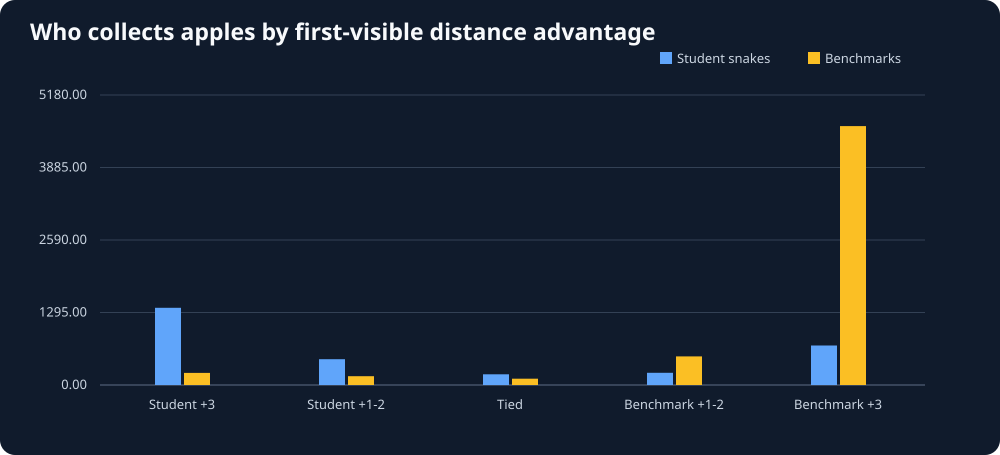
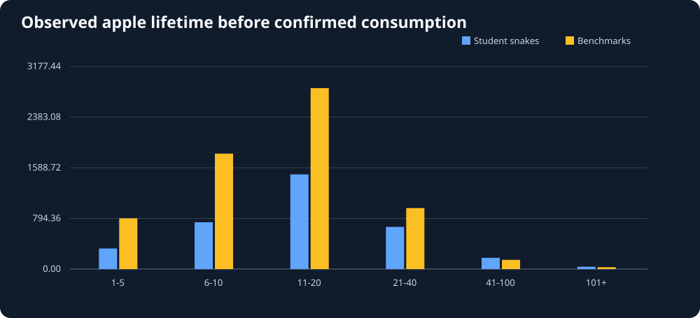

# Snake26 Food Races: Observational Study

Generated UTC: 2026-11-03T06:58:24+00:00

## Data validity FIRST

- Replay files scanned: **220** of 220; unique content: **150**.
- Exact duplicates skipped: **70**; unreadable replays: **0**.
- First-visible apple episodes: **18054**.
- Apples disappearing between adjacent states: **17909**.
- Captures matched to next-head position AND explicit eat event: **17905**.
- Unmatched disappearances: **4**.
- Confirmation rate among disappeared apples: **100.0%**.
- On-arrival matched apple events: **8580**; league matched events: **9325**.

> The measurement is conservative. A disappearing apple without BOTH
> a matching eat event and next-frame head is not assigned a winner.
> A low confirmation rate could indicate timing/schema mismatch.
> A first-visible apple may already have existed before a replay started.

## 1. Apples won by starting-distance advantage

At each first-visible apple location, we measure the toroidal Manhattan
distance from the nearest living student head and nearest built-in benchmark head.
Student +3 means the student head was at least three cells closer.
We then identify which type ACTUALLY consumed the apple, using recorded events.
Bars show observed counts only, **not normalized win probabilities**.

## 2. How long did those apples remain available?

Duration is turns from first visible board coordinate to confirmed capture.
It does NOT mean the winner deliberately pursued that apple the entire time.
Unconsumed/censored opportunities are not included in the lifetime histogram.

## 3. Close competitive opportunities

We call an apple initially contested when the student versus benchmark
nearest-head distances differ by at most two cells, and at least one head
is at toroidal Manhattan distance ten or less at first appearance.
Observed matched contested captures: **506**.
- Student captured: **268**.
- Built-in benchmark captured: **238**.

That is an operational distance-based definition, not proof of
the actual safe paths, intentions or likelihood of winning.

## 4. Environment coverage

| Mode | Matched apple captures | Student captures | Benchmark captures |
|---|---:|---:|---:|
| On-arrival | 8580 | 2957 | 5623 |
| League | 9325 | 9325 | 0 |

## Next research questions

1. For each new apple, inspect time-to-first-target movement and the route actually taken.
2. Compare occupied-path distance rather than toroidal Manhattan distance alone.
3. Stratify by student identity, bot code hash, turn, length, and opponent group.
4. Quantify head-on collision threats during near-tie contests.
5. Analyze missing/disappearing-event coverage before making strong claims.

### Interpretation rules

- Archived actions do not tell us why a bot chose a route.
- Food disappearing without a matching event is missing evidence, not a loss.
- Recorded opponents would react differently to hypothetical player moves.
- Multiple captures per match are correlated. Avoid naive independent confidence intervals.
- Do not implement a new Snake AI during this research-only phase.
