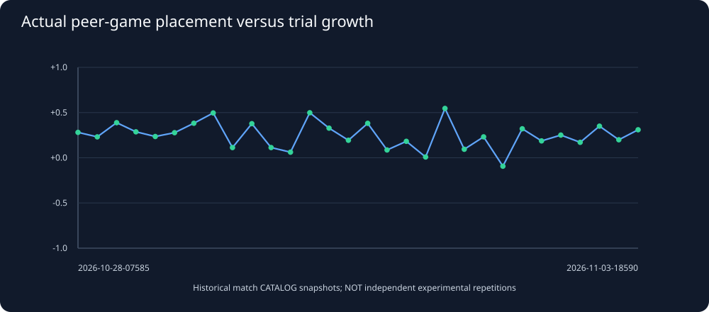

# Snake26 historical league outcomes versus fixed trials

Generated UTC: 2026-11-03T07:01:19+00:00

## Why this analysis exists

We have many historical league match CATALOGS but relatively few saved
official standings for old seasons. To use those actual student-vs-student
games, we compute each student's average recorded league **placement**
among at least three peer matches in one season and one match division.
We compare it to that student's mean final length in all three on-arrival
trial suites. Division is taken from the recorded league MATCH, not inferred
from a missing official standings table.

This is **not official rank** and must never be reported as official rank.
Different league schedules and opponents affect placement. Many hourly
snapshots reuse bots, seeds and exact match results, so the history is
NOT a series of independent replications.

## Coverage

- Season/division cohorts with at least 10 eligible students: **187**.
- Distinct seasons represented: **101**.
- Division 1 snapshots: **101**.
- Eligible student/season/division records: **5051**.
- Excluded student-seasons with fewer than 3 peer league games: **52**.
- Excluded student-seasons with conflicting match divisions: **0**.
- Excluded student-seasons without all three trial suites: **24**.

## Student-vs-student placement correlation with benchmark growth

A positive Spearman correlation means a student with better average
league placement (smaller numerical place) tends to grow longer in trials
(larger numerical length) *within the same season and match division*.
It does NOT establish that benchmark growth causes league success.

| Indexed season | Division 1 students | Spearman rho | Avg peer matches/student | Official ranks saved? |
|---|---:|---:|---:|---:|
| 2026-11-03-055900-season | 32 | +0.321 | 5 | 32/32 |
| 2026-11-03-045900-season | 31 | -0.093 | 4.6 | 0/31 |
| 2026-11-03-025900-season | 32 | +0.231 | 4.6 | 32/32 |
| 2026-11-03-015900-season | 32 | +0.094 | 4.8 | 0/32 |
| 2026-11-02-225901-season | 32 | +0.546 | 5 | 32/32 |
| 2026-11-02-215901-season | 32 | +0.009 | 4.6 | 0/32 |
| 2026-11-02-145901-season | 32 | +0.182 | 4.9 | 32/32 |
| 2026-11-02-135859-season | 32 | +0.086 | 5 | 0/32 |
| 2026-11-02-045859-season | 32 | +0.381 | 5.4 | 32/32 |
| 2026-11-02-035859-season | 31 | +0.194 | 5.0 | 0/31 |
| 2026-11-01-235859-season | 32 | +0.328 | 4.6 | 32/32 |
| 2026-11-01-225859-season | 32 | +0.498 | 5.1 | 32/32 |
| 2026-11-01-215859-season | 32 | +0.062 | 5.6 | 32/32 |
| 2026-11-01-205859-season | 32 | +0.113 | 4.5 | 32/32 |
| 2026-11-01-195859-season | 32 | +0.377 | 4.5 | 0/32 |
| 2026-10-29-055859-season | 29 | +0.278 | 4.4 | 0/29 |
| 2026-10-29-035858-season | 32 | +0.235 | 4.5 | 0/32 |
| 2026-10-29-005901-season | 32 | +0.287 | 4.9 | 0/32 |
| 2026-10-28-185900-season | 32 | +0.388 | 5 | 0/32 |
| 2026-10-28-115857-season | 32 | +0.231 | 5 | 0/32 |
| 2026-10-28-075857-season | 32 | +0.281 | 4.6 | 0/32 |
| 2026-10-28-065857-season | 32 | -0.050 | 4.5 | 0/32 |
| 2026-10-28-055857-season | 32 | +0.263 | 4.4 | 0/32 |
| 2026-10-24-065857-season | 32 | +0.142 | 4.9 | 0/32 |

## Interpretation and responsible next actions

If league/trial ranking gaps persist across historical snapshots with
the same recorded SHA, they are *hypotheses* about robustness, not proof
of unchanged executable code. Select mismatched performers for full replay
case studies; pair growth, actual deaths, threat exposure and length
retention, controlling for opponents and game phase.

## Downloadable derived inputs

- [Season-by-division peer-game correlations](../derived/historical_peer_trial_correlations.csv)
- [Student-level source rows](../derived/historical_peer_trial_students.csv)
No competition snake has been altered.
