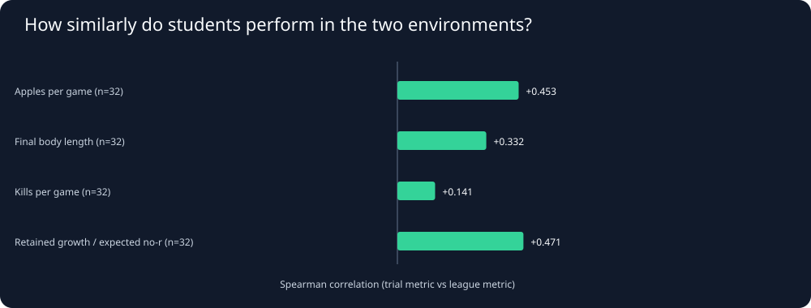
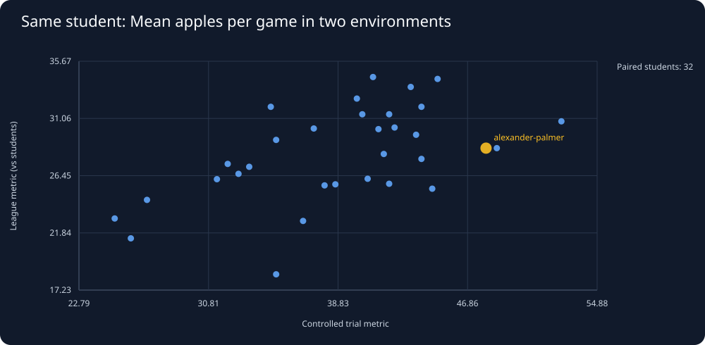
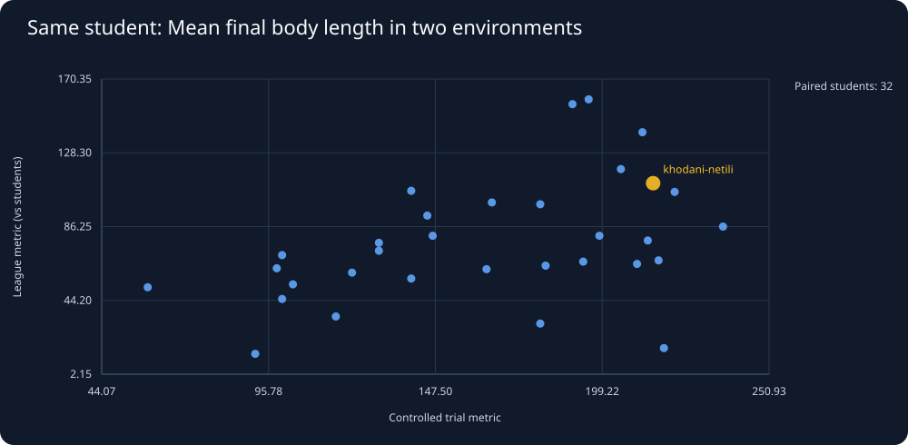
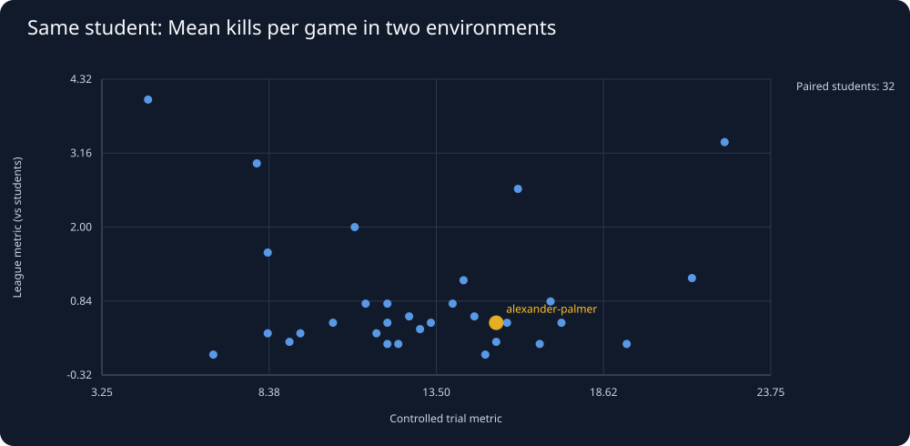
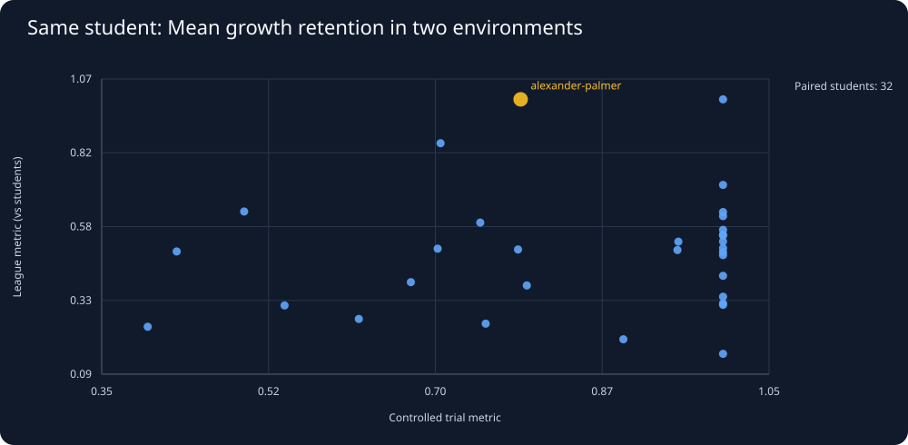
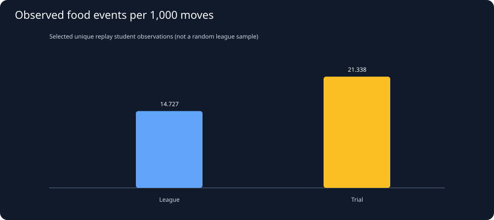
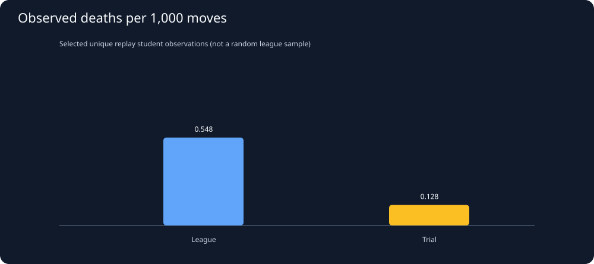
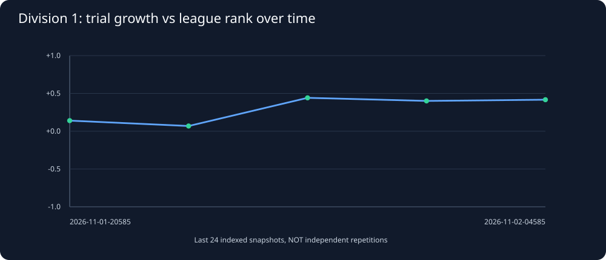
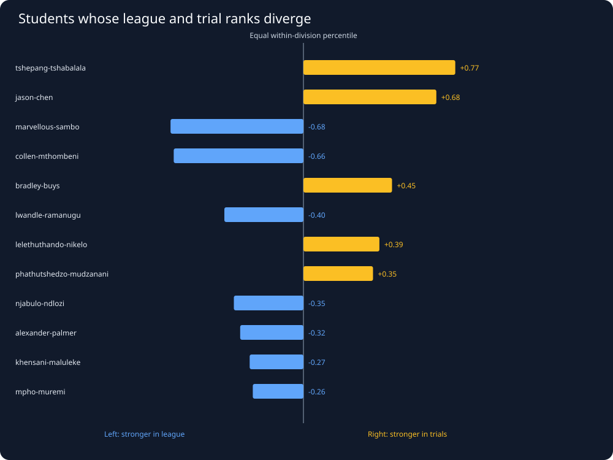
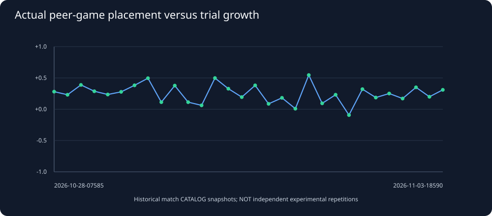

# Snake26: JOINED league + trials study

Generated UTC: 2026-11-02T06:14:41+00:00

**Latest official season:** 2026-11-02-045859-season. This report treats competitive league
matches and controlled on-arrival trials as **two separate datasets**
and joins them at the **same season + same student**. The published
end-of-season code SHA, when known, is attached for auditing, but is
**not proof that every match in that season used that exact code version**.

## 1. Data provenance and cleaning

**Source of truth:** official public Wits catalog records in the SQLite archive.

| Separate data source | Cataloged matches | Full replays | Unique replay hashes |
|---|---:|---:|---:|
| League | 3,356 | 113 | 59 |
| Trial | 26,280 | 67 | 54 |

**Historical student-season rows:** league 2,542,
trials 8,760, union 8,780.
**Current season paired students (at least 2 student-opponent league games
plus all 3 trials): 145**.
**Division 1 study sample (at least 3 league games + all trials): 32**.

Important: a cataloged game is not automatically a recorded full replay.
We do not estimate actions, decisions, deaths or attack policy from aggregate
placements. Identical SHA replay payloads are counted separately in catalog
coverage but not as independent unique recordings.
**Possible mechanics/data inconsistencies** (final length larger than
5 + 5 times apples) among student-game observations: 0.
Investigate any nonzero cases before interpreting reset behavior.

## 2. Correlations between SAME students in both environments

| Paired measurement | Division 1 students | Spearman rho | Exploratory 95% paired-student bootstrap interval |
|---|---:|---:|---:|
| Apples per game | 32 | 0.469 | [+0.118, +0.714] |
| Final body length | 32 | 0.164 | [-0.227, +0.510] |
| Kills per game | 32 | 0.010 | [-0.403, +0.438] |
| Retained growth / expected no-reset growth | 32 | 0.215 | [-0.144, +0.538] |

Correlations are calculated only among students from **the same division
and season**, to avoid comparing ranks of different divisions. These are
within-student comparisons across distinct conditions—not claims that
one environment causes performance in the other.
The exploratory 95% percentile intervals resample complete paired STUDENTS
(2,000 draws per metric), not frames or individual games. They do NOT
adjust for league schedule differences, opponent difficulty, code changes
or selection bias. This is one time-specific Division 1 cohort.

## 3. Compare actual outcomes side by side

Every dot represents one matched student-season. The x-axis is the
three-trial average; y-axis is the actual league average against
at least two student opponents. Trial seeds are fixed, while league
match opponents, seats and seeds vary by schedule.

## 4. Current Division 1: actual joined rows

| Rank | Student | League games | League wins % | League apples | League retained | League kills | Trial apples | Trial retained | Trial kills | Replay coverage L/T |
|---:|---|---:|---:|---:|---:|---:|---:|---:|---:|---:|
| 1 | 421462-alexander-palmer | 6 | 83.3 | 38.2 | 0.74 | 0.50 | 48.0 | 0.79 | 15.33 | 6/0 |
| 2 | 427064-khodani-netili | 5 | 60.0 | 30.2 | 0.84 | 0.80 | 42.0 | 1.00 | 11.33 | 2/0 |
| 3 | 427039-sameeha-miabala | 6 | 66.7 | 26.3 | 0.84 | 1.17 | 38.7 | 1.00 | 14.33 | 0/0 |
| 4 | 424820-elisha-mundalamo | 4 | 50.0 | 30.0 | 0.77 | 0.50 | 40.3 | 0.95 | 13.33 | 0/0 |
| 5 | 428786-marvellous-sambo | 5 | 60.0 | 30.8 | 0.71 | 2.60 | 34.7 | 0.70 | 16.00 | 1/0 |
| 6 | 403339-david-ndambo | 5 | 40.0 | 31.6 | 0.71 | 0.60 | 41.3 | 1.00 | 12.67 | 1/0 |
| 7 | 419926-mphile-nchabeleng | 5 | 40.0 | 31.6 | 0.44 | 0.80 | 35.0 | 1.00 | 14.00 | 1/0 |
| 8 | 428954-njabulo-ndlozi | 6 | 33.3 | 27.7 | 0.42 | 0.83 | 37.3 | 0.75 | 17.00 | 1/0 |
| 9 | 388828-ngcebo-methula | 5 | 60.0 | 36.8 | 0.39 | 0.60 | 40.0 | 1.00 | 14.67 | 2/0 |
| 10 | 402334-angile-saho | 6 | 33.3 | 29.3 | 0.63 | 0.17 | 52.7 | 0.78 | 19.33 | 1/0 |
| 11 | 408070-collen-mthombeni | 5 | 40.0 | 29.0 | 0.86 | 4.00 | 42.3 | 0.50 | 4.67 | 0/0 |
| 12 | 403754-vhuimo-mudau | 6 | 16.7 | 28.7 | 0.78 | 2.00 | 35.3 | 1.00 | 11.00 | 1/0 |
| 13 | 423135-mpho-muremi | 5 | 0.0 | 24.2 | 0.81 | 1.20 | 26.0 | 1.00 | 21.33 | 0/0 |
| 14 | 413538-lelethuthando-nikelo | 6 | 16.7 | 28.3 | 0.58 | 3.33 | 43.3 | 1.00 | 22.33 | 2/0 |
| 15 | 419342-ayeshan-puckree | 6 | 33.3 | 28.3 | 0.65 | 0.17 | 32.0 | 1.00 | 12.33 | 2/0 |
| 16 | 421349-phathutshedzo-mudzanani | 6 | 33.3 | 29.5 | 0.31 | 0.50 | 43.7 | 0.95 | 10.33 | 0/0 |
| 17 | 389160-lwandle-ramanugu | 6 | 0.0 | 26.8 | 0.44 | 0.50 | 38.0 | 0.54 | 17.33 | 1/0 |
| 18 | 423436-ntobeko-zondi | 4 | 25.0 | 25.5 | 0.62 | 0.50 | 33.3 | 1.00 | 12.00 | 0/0 |
| 19 | 408501-asher-urison | 5 | 20.0 | 24.2 | 0.72 | 3.00 | 38.3 | 0.70 | 8.00 | 0/0 |
| 20 | 426895-mpho-ramasakona | 4 | 25.0 | 25.8 | 0.89 | 0.50 | 40.7 | 0.54 | 15.67 | 0/0 |
| 21 | 404721-khensani-maluleke | 5 | 0.0 | 35.2 | 0.32 | 0.40 | 45.0 | 0.43 | 13.00 | 0/0 |
| 22 | 403501-mashau-mudzanani | 6 | 16.7 | 32.8 | 0.22 | 0.33 | 41.3 | 0.75 | 8.33 | 1/0 |
| 23 | 406000-mulimisi-rammela | 5 | 20.0 | 19.6 | 0.83 | 0.80 | 25.0 | 1.00 | 12.00 | 1/0 |
| 24 | 419636-jason-chen | 5 | 20.0 | 25.2 | 0.27 | 0.00 | 42.7 | 1.00 | 6.67 | 0/0 |
| 25 | 388060-tshepang-tshabalala | 6 | 0.0 | 32.5 | 0.32 | 0.00 | 44.7 | 1.00 | 15.00 | 2/0 |
| 26 | 422777-thandile-mamiana | 5 | 0.0 | 17.6 | 0.91 | 1.60 | 35.0 | 0.81 | 8.33 | 1/0 |
| 27 | 419222-asisipho-ngaba | 6 | 0.0 | 23.0 | 0.40 | 0.33 | 41.3 | 0.64 | 11.67 | 0/0 |
| 28 | 419810-sokhna-diop | 6 | 16.7 | 21.2 | 0.31 | 0.17 | 32.3 | 0.80 | 12.00 | 1/0 |
| 29 | 408008-bradley-buys | 6 | 0.0 | 25.0 | 0.23 | 0.17 | 42.0 | 0.76 | 16.67 | 1/0 |
| 30 | 425488-zinhle-zitha | 5 | 0.0 | 26.2 | 0.29 | 0.20 | 41.0 | 0.64 | 9.00 | 0/0 |
| 31 | 429782-maseeha-seedat | 5 | 0.0 | 31.4 | 0.29 | 0.20 | 38.3 | 0.50 | 15.33 | 1/0 |
| 32 | 428464-madalitso-mnqanqeni | 6 | 0.0 | 32.0 | 0.29 | 0.33 | 41.7 | 0.50 | 9.33 | 3/0 |

## 5. The same students: *actual replay-derived* behavior

Current-season students with BOTH league and trial full replay behavior: **0**.
Catalog counts cannot fill in missing replay decisions; only identical,
verifiable frame-derived definitions can be compared across modes.
[See the mode-separated behavioral report](behavior_by_mode.md) for
observed food-event/death rates and their conditional correlations.

## 6. Longitudinal disagreement: league specialists vs trial specialists

Historical Division 1 snapshots with matched outcome comparisons: **5**.
We rank the same eligible students within each official division and
season, then compare league versus trial percentiles. Repeated hourly
snapshots are correlated and do not form independent experiments.
[Open the historical disagreement study](seasonal_disagreement.md).

## 7. Older seasons with actual peer games but no saved standings

Historical seasons comparable by match-derived Division 1 outcomes: **58** snapshots.
This study uses cataloged student-versus-student placements when old
OFFICIAL rankings were not archived. These are explicitly labeled
match-derived outcomes, never represented as official league rank.
[Open historical peer-game versus trial results](historical_peer_comparison.md).

## 8. Reproducible joined data exports

- [League team-season summaries](../derived/league_team_seasons.csv) —
  the real competition outcomes, including human-opponent counts.
- [Trial team-season summaries](../derived/trial_team_seasons.csv) —
  three controlled benchmark setups, kept separate.
- [Joined student-season dataset](../derived/joined_team_seasons.csv) —
  one row per student and season; missing sides are **missing**, not zero.
- [Historical game-based peer performance comparisons](../derived/historical_peer_trial_correlations.csv) —
  actual archived matches; does NOT imply missing official rank.
- [Historical league–trial student rank gaps](../derived/seasonal_rank_gaps.csv) —
  comparable within-division student-season ranks; snapshots not independent.
- [Replay-backed behavior, separated by mode](../derived/replay_behavior_by_mode.csv) —
  only downloaded full match observations.
- [Data validation summary](../derived/quality.json) —
  replay coverage, SHA deduplication and sample sizes.

## 9. What needs further evidence

1. Obtain full league replays of top Division 1 students, including both
   winners and losers, and map their exact turns/deaths/food contests.
2. Run the **same replay-derived definitions** separately on league and
   on-arrival data: food pursuit, death risk, contest pressure and mobility.
3. Compare like-for-like length, turn phase, opponent skill and version.
4. Group uncertainty by complete match/season, not thousands of turns.
5. Interpret only held-out, version-aware patterns before changing our snake.

This joined report establishes observational associations, not an optimal
aggression/safety formula. No competition snake code has been modified.
