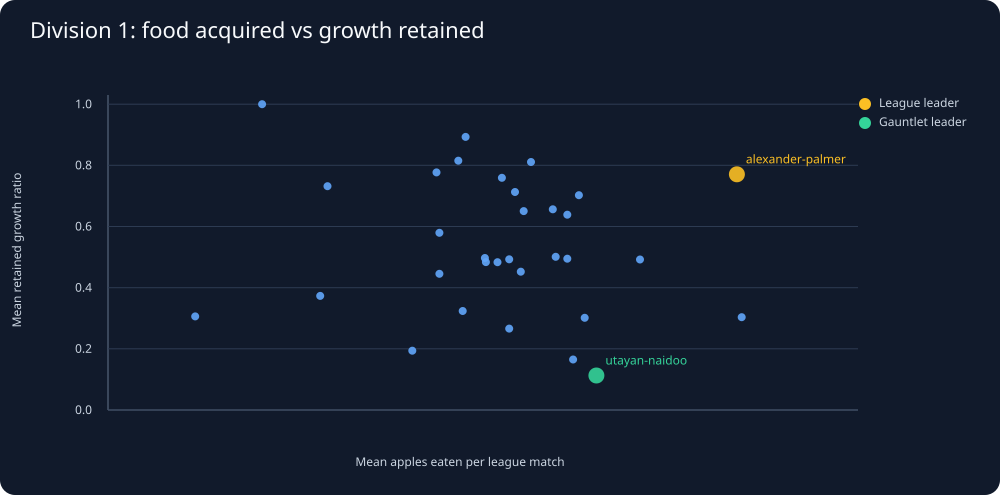

# Snake26: League aggression vs growth-retention hypothesis

Generated UTC: 2026-11-01T23:37:35+00:00

## Data design

Latest official season: 2026-11-01-225859-season. Division 1 group: 32 students.
Included students with at least 3 recorded league matches and usable food/length: 32.

A length-retention proxy is final length divided by 5 plus 5 times ALL apples eaten.
This can detect lost growth from resets but cannot reconstruct exact death timing.
Each student faces a different schedule; raw averages do not control for opponent strength.

## The apparent risk-versus-food tradeoff

The upper-right area represents students who collect more apples and retain more
resulting length in these match samples. It is not a proven optimum.

## Which league outcomes align with official Division 1 ranking?

| Metric | Bots with matches | Spearman agreement with official league rank |
|---|---:|---:|
| Mean apples per league match | 32 | 0.319 |
| Mean retained growth ratio | 32 | 0.515 |
| Mean kills per league match | 32 | 0.632 |
| Mean final body length | 32 | 0.661 |
| League first-place frequency | 32 | 0.774 |

Positive means higher performance on that metric tends to align with better
official standing. League win rate and rank are related game outcomes; their
correlation is NOT independent evidence for a specific movement strategy.

## Specific students worth comparing in full replays

| Student | Division 1 rank | League matches | League win % | Mean apples | Mean length | Mean retained growth | Gauntlet final length |
|---|---:|---:|---:|---:|---:|---:|---:|
| 421462-alexander-palmer | 1 | 3 | 66.7 | 28.7 | 95.0 | 0.70 | 215 |
| 409997-utayan-naidoo | 26 | 6 | 16.7 | 28.7 | 31.7 | 0.21 | 255 |
| 428786-marvellous-sambo | 2 | 5 | 60.0 | 32.0 | 124.0 | 0.74 | 20 |
| 388828-ngcebo-methula | 3 | 6 | 66.7 | 32.7 | 78.3 | 0.47 | 200 |
| 403339-david-ndambo | 4 | 5 | 80.0 | 30.2 | 126.0 | 0.84 | 205 |
| 427039-sameeha-miabala | 5 | 4 | 50.0 | 25.8 | 133.8 | 1.00 | 200 |
| 413538-lelethuthando-nikelo | 6 | 5 | 20.0 | 33.6 | 110.0 | 0.64 | 190 |
| 421349-phathutshedzo-mudzanani | 7 | 4 | 25.0 | 29.8 | 85.0 | 0.56 | 240 |
| 427064-khodani-netili | 8 | 5 | 40.0 | 31.4 | 64.0 | 0.40 | 240 |
| 419926-mphile-nchabeleng | 9 | 6 | 33.3 | 29.3 | 92.5 | 0.61 | 180 |
| 424820-elisha-mundalamo | 10 | 5 | 20.0 | 31.4 | 123.0 | 0.78 | 180 |

## Why we cannot yet declare a sweet spot

- Only a handful of current-season games per student are currently cataloged.
- Different opponents, starts, seats, maps and versions can change outcomes.
- A mean retained ratio is a reset proxy, not proof of risk-aversion or aggression.
- Final-length evidence cannot tell whether the snake deliberately avoided fights.
- Needed: elite league replays with apple choices, head threats, deaths and escape routes.
- Test per-match and per-bot-version uncertainty before proposing a movement rule.

The same research cycle must continue collecting and analyzing benchmark trials.
No new competition agent code is implemented in this analysis.
