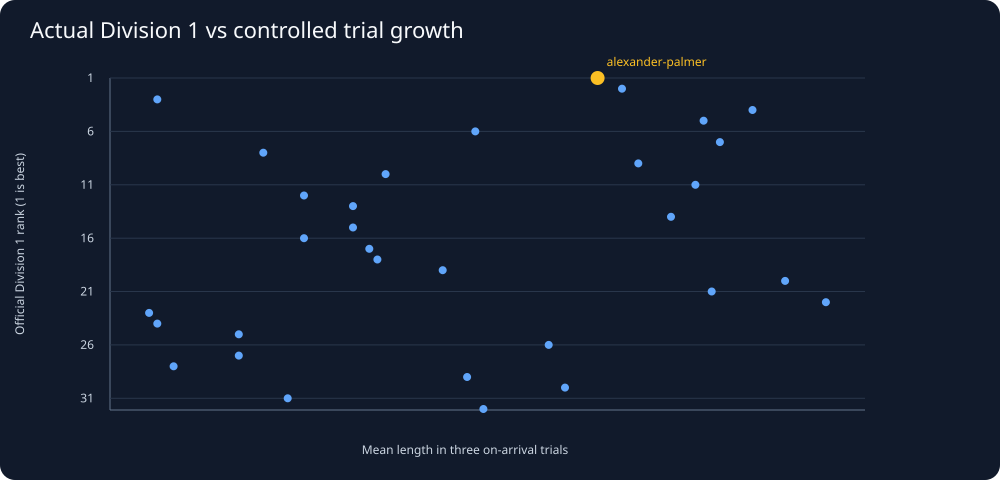
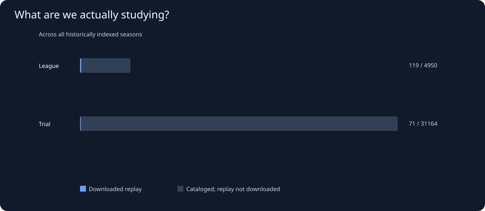

# Snake26: League versus on-arrival trials

Generated UTC: 2026-11-02T06:08:32+00:00
Latest season with official standings: 2026-11-02-045859-season

## 1. Are league and benchmark results consistent?

| Division | Students with all trials | Official rank vs mean trial length (Spearman) | Official rank vs gauntlet length (Spearman) |
|---|---:|---:|---:|
| 1 | 32 | 0.417 | 0.394 |
| 2 | 32 | 0.522 | 0.556 |
| 3 | 32 | 0.361 | 0.176 |
| 4 | 32 | 0.098 | -0.059 |
| 5 | 17 | 0.890 | 0.815 |

Positive correlation means better official ranking tends to align with better trial lengths.
Never compare division-specific rank numbers across divisions: Division 2 rank 1 is not Division 1 rank 1.
Official standings can reflect accumulated scoring; these are cross-sectional associations.

## 2. Which snakes demonstrate the gap?

| Group | Student | Division/rank | Combined trial rank | Mean trial final length | Gauntlet final length |
|---|---|---|---:|---:|---:|
| League champion | 421462-alexander-palmer | 1/1 | 19 | 190.0 | 215 |
| Best combined trials | 422453-mauricetshepo-frost | 2/20 | 1 | 248.3 | 235 |
| Best gauntlet_1 | 409997-utayan-naidoo | 2/12 | 17 | 193.3 | 255 |

## 3. What do REAL league match results reveal?

Some official league games also have built-in filler opponents. We distinguish
student-only matches from mixed matches and compare only catalog games
with at least two actual students.

| Latest league format | Games cataloged | Full replays saved |
|---|---:|---:|
| mixed / 1 students | 2 | 0 |
| student-only / 4 students | 168 | 8 |

League metrics below use official match catalog outcomes, not any assumed
strategy inferred from replay. Win rate and mean placement are per-game observations.
Retained ratio means final length divided by (5 + 5 times total apples); it can
indicate growth lost to resets but cannot identify the number or timing of deaths.

| Div 1 rank | Student | League matches | Win % | Mean place | Mean apples | Mean kills | Mean length | Retained ratio | League replays | Trial rank |
|---:|---|---:|---:|---:|---:|---:|---:|---:|---:|---:|
| 1 | 421462-alexander-palmer | 6 | 83.3 | 1.2 | 38.2 | 0.5 | 147.5 | 0.74 | 6 | 19 |
| 2 | 427064-khodani-netili | 5 | 60.0 | 1.4 | 30.2 | 0.8 | 126.0 | 0.84 | 2 | 6 |
| 3 | 427039-sameeha-miabala | 6 | 66.7 | 1.5 | 26.3 | 1.2 | 114.2 | 0.84 | 0 | 14 |
| 4 | 424820-elisha-mundalamo | 4 | 50.0 | 2.0 | 30.0 | 0.5 | 123.8 | 0.77 | 0 | 16 |
| 5 | 428786-marvellous-sambo | 5 | 60.0 | 1.8 | 30.8 | 2.6 | 115.0 | 0.71 | 1 | 95 |
| 6 | 403339-david-ndambo | 5 | 40.0 | 1.8 | 31.6 | 0.6 | 108.0 | 0.71 | 1 | 8 |
| 7 | 419926-mphile-nchabeleng | 5 | 40.0 | 2.0 | 31.6 | 0.8 | 66.0 | 0.44 | 1 | 24 |
| 8 | 428954-njabulo-ndlozi | 6 | 33.3 | 1.8 | 27.7 | 0.8 | 59.2 | 0.42 | 1 | 43 |
| 9 | 388828-ngcebo-methula | 5 | 60.0 | 1.8 | 36.8 | 0.6 | 81.0 | 0.39 | 2 | 10 |
| 10 | 402334-angile-saho | 6 | 33.3 | 2.2 | 29.3 | 0.2 | 99.2 | 0.63 | 1 | 12 |
| 11 | 408070-collen-mthombeni | 5 | 40.0 | 2.2 | 29.0 | 4.0 | 132.0 | 0.86 | 0 | 68 |
| 12 | 403754-vhuimo-mudau | 6 | 16.7 | 2.3 | 28.7 | 2.0 | 112.5 | 0.78 | 1 | 23 |
| 13 | 423135-mpho-muremi | 5 | 0.0 | 2.2 | 24.2 | 1.2 | 104.0 | 0.81 | 0 | 45 |
| 14 | 413538-lelethuthando-nikelo | 6 | 16.7 | 2.5 | 28.3 | 3.3 | 88.3 | 0.58 | 2 | 3 |
| 15 | 419342-ayeshan-puckree | 6 | 33.3 | 2.5 | 28.3 | 0.2 | 95.0 | 0.65 | 2 | 32 |
| 16 | 421349-phathutshedzo-mudzanani | 6 | 33.3 | 2.5 | 29.5 | 0.5 | 48.3 | 0.31 | 0 | 7 |
| 17 | 389160-lwandle-ramanugu | 6 | 0.0 | 2.5 | 26.8 | 0.5 | 55.0 | 0.44 | 1 | 98 |
| 18 | 423436-ntobeko-zondi | 4 | 25.0 | 2.5 | 25.5 | 0.5 | 82.5 | 0.62 | 0 | 27 |
| 19 | 408501-asher-urison | 5 | 20.0 | 2.8 | 24.2 | 3.0 | 85.0 | 0.72 | 0 | 41 |
| 20 | 426895-mpho-ramasakona | 4 | 25.0 | 2.5 | 25.8 | 0.5 | 111.2 | 0.89 | 0 | 59 |
| 21 | 404721-khensani-maluleke | 5 | 0.0 | 2.6 | 35.2 | 0.4 | 58.0 | 0.32 | 0 | 67 |
| 22 | 403501-mashau-mudzanani | 6 | 16.7 | 2.8 | 32.8 | 0.3 | 40.8 | 0.22 | 1 | 37 |
| 23 | 406000-mulimisi-rammela | 5 | 20.0 | 2.6 | 19.6 | 0.8 | 87.0 | 0.83 | 1 | 49 |
| 24 | 419636-jason-chen | 5 | 20.0 | 3.0 | 25.2 | 0.0 | 42.0 | 0.27 | 0 | 4 |
| 25 | 388060-tshepang-tshabalala | 6 | 0.0 | 3.0 | 32.5 | 0.0 | 54.2 | 0.32 | 2 | 2 |
| 26 | 422777-thandile-mamiana | 5 | 0.0 | 3.2 | 17.6 | 1.6 | 83.0 | 0.91 | 1 | 44 |
| 27 | 419222-asisipho-ngaba | 6 | 0.0 | 3.2 | 23.0 | 0.3 | 52.5 | 0.40 | 0 | 50 |
| 28 | 419810-sokhna-diop | 6 | 16.7 | 3.2 | 21.2 | 0.2 | 31.7 | 0.31 | 1 | 53 |
| 29 | 408008-bradley-buys | 6 | 0.0 | 3.3 | 25.0 | 0.2 | 29.2 | 0.23 | 1 | 31 |
| 30 | 425488-zinhle-zitha | 5 | 0.0 | 3.4 | 26.2 | 0.2 | 39.0 | 0.29 | 0 | 52 |
| 31 | 429782-maseeha-seedat | 5 | 0.0 | 3.4 | 31.4 | 0.2 | 47.0 | 0.29 | 1 | 69 |
| 32 | 428464-madalitso-mnqanqeni | 6 | 0.0 | 3.5 | 32.0 | 0.3 | 46.7 | 0.29 | 3 | 63 |

## 4. How biased is our replay collection?

| Mode | Catalog records | Downloaded replays | Unique byte-identical replay payloads | Coverage |
|---|---:|---:|---:|---:|
| league | 3,966 | 113 | 59 | 2.85% |
| trial | 26,280 | 67 | 54 | 0.25% |

The total number of historical catalogs is NOT the count of independent bot matches;
replays, opponents, seeds and bot versions may repeat across seasons.
If league replay coverage is small, detailed claims about league navigation
or aggression are premature.

## 5. Testing the proposed aggression/safety sweet spot

Our hypothesis is that competitive leaders optimize both growth and survival.
That is plausible but unproven. Compare for each bot and game type:
- Food acquisition: apples per alive turn, contested captures, route progress.
- Risk management: deaths per 1,000 alive turns, body collision causes, safe-space preservation.
- Aggression: kills per game, head-on approach rates, pressures around contested apples.
- Retention: final body length versus all accumulated apples, accounting for resets.
- Adaptation: changes to the same team's behavior in trials versus real league matches.
Match code versions and opponent composition; bootstrap uncertainty by entire match.

## Next steps
Rebalance replay downloads toward League Division 1 and genuine student-versus-student
situations while maintaining substantial coverage of on-arrival benchmark trials.
Do not implement another competition snake until those comparisons are tested.
