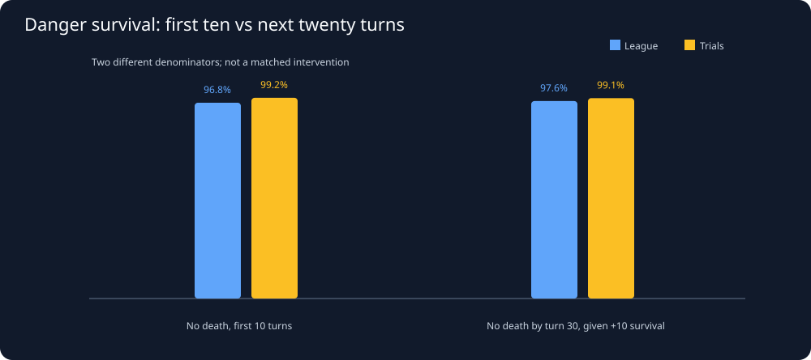
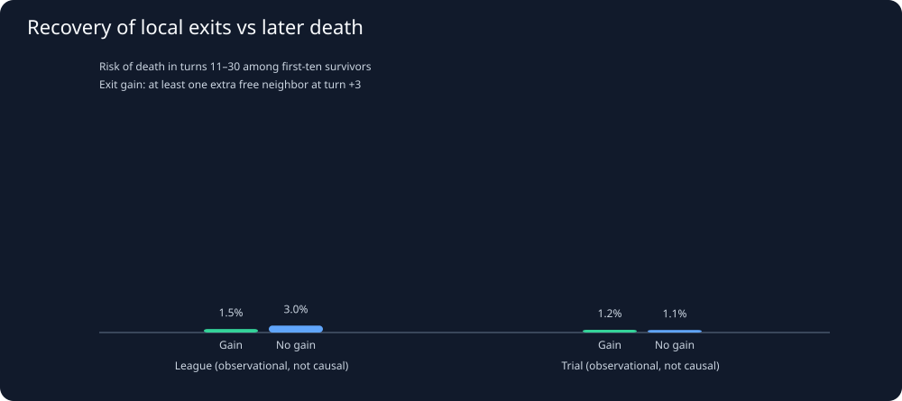

# Snake26: Do escapes stay safe for the next 20–30 turns?

Generated UTC: 2026-11-06T11:08:09+00:00

## Study design
Actual student replay frames are sampled every 25 turns when the nearest
opponent head is within three toroidal cells OR the snake has at most one
unoccupied neighboring square. We distinguish league peers from fixed
benchmark trials and deduplicate replay payloads by SHA-256.
A recorded death event is FAILURE even if the snake later respawns.
A missing frame or unexplained disappearance is CENSORED, never safe.
Outcomes are death-free through +10, +20 or +30 turns. Since +30
covers longer than the 25-turn sampling stride, windows from the same
snake and match can overlap; resample entire replay clusters.

## Data quality
Files scanned: **250** / 260.
Unique replay payloads: **181** (league 102, trials 79).
Duplicate payloads: **69**.
Unreadable files: **0**.
Dangerous starting positions: **4,451**.
Silent snake disappearances censored: **0**.

## 1. Actual death-free followup

| Mode | Baseline danger windows | Dead by +10 | Survived +10 | Alive at +20 after +10 (known only) | Alive at +30 after +10 (known only) | Censored before +30 |
|---|---:|---:|---:|---|---|---:|
| league | 3789 | 120 | 3669 | 3627/3669 (98.86%) | 3538/3618 (97.79%) | 51 |
| trial | 662 | 4 | 658 | 653/658 (99.24%) | 647/653 (99.08%) | 5 |

The +20 and +30 percentages condition on first-ten survival AND having
a known future outcome. Never confuse them with unconditional survival.

## 2. Does recovering an extra exit at +3 predict death in turns 11–30?

Analyze only snakes surviving to +10. Exits are an immediate geometry
proxy, not guaranteed legal directions or long-horizon path safety.
| Mode | +3 escape-space change | Survived first 10 | Known outcome at +30 | Dead in +11..+30 | Conditional death % | Censored |
|---|---|---:|---:|---:|---:|---:|
| league | Gained at least one exit | 1418 | 1392 | 18 | 1.29% | 26 |
| league | No new exit | 2251 | 2226 | 62 | 2.79% | 25 |
| trial | Gained at least one exit | 216 | 213 | 2 | 0.94% | 3 |
| trial | No new exit | 442 | 440 | 4 | 0.91% | 2 |

## 3. Match-cluster bootstrap for late death difference
Difference is exit-GAINERS minus NON-gainers, in percentage points.
Negative would favor gainers, positive would favor non-gainers.
This is observational and subject to selection and opponent confounding.

| Mode | Observed difference (percentage points) | Exploratory 95% replay-bootstrap CI | Replay clusters |
|---|---:|---:|---:|
| league | -1.49 | [-2.40, -0.68] | 102 |
| trial | 0.03 | [-1.35, 1.83] | 78 |

## 4. Palmer compared with actual students in the same league games
Unique league replays with Palmer danger windows: **40**.
These are real same-game opponent observations, but not exactly
matched head positions, lengths, or player skill.

| Role | Danger windows | Survived +10 | Known +30 after +10 | Survived +30 | Mean +3 free-exit change |
|---|---:|---:|---:|---:|---:|
| Palmer | 382 | 381 | 377 | 374 | 0.33 (n=381) |
| Other students in Palmer games | 1147 | 1104 | 1097 | 1076 | 0.36 (n=1104) |

## 5. Palmer's actual decision sequences in individual league replays
Audited games in the [Palmer casebook](palmer_casebook.md): **40**.
Games with a comparable starting-danger peer in the SAME replay: **37**.
The casebook exposes actual movement direction and straight-versus-turn
choice plus neighboring-space, head-distance and food observations
through turns +1, +3, +10, +20 and +30 where recorded.
We select the earliest qualifying danger in each replay, never
cherry-pick a successful later move.
[Open Palmer's complete observed casebook](palmer_casebook.md).

## 6. Interpretation and next experiment
A successful first escape does not guarantee another twenty safe turns.
Early mobility recovery and late survival can be associated without
the move CAUSING survival. Conditioning on +10 survival selects a
nonrandom subset of snakes; initial body geometry, head trajectories,
apples, opponent strength and season/version remain confounders.
Next, investigate close-call turns with head direction, legal move
options and contested food in the SAME games. Only then consider
testing candidate policy changes on held-out seeds.

## Auditable observations
[Censor-aware 10/20/30-turn danger windows](../derived/long_horizon_danger_windows.csv).
[Matched real escape/autopsy report](escape_autopsies.md).
[Canonical joined league/trial dashboard](joint_analysis.md).

**No Java competition snake code was changed.**
