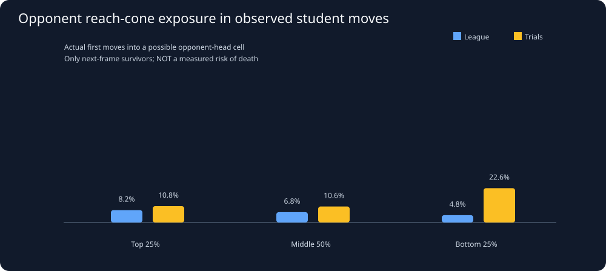

# Snake26: Opponent next-head reachability across league and trials

Generated UTC: 2026-11-02T23:45:13+00:00

## What was tested

For every actual dangerous student position, derive all opponent
one-step head destinations from current head and neck on the
toroidal board. With a known heading, exclude immediate reversal;
otherwise include all four cardinal neighbors. No occupancy filter
is applied to opponents, so these sets are geometric UPPER BOUNDS,
not legal moves, probabilistic predictions or certain deaths.
Equal/longer CURRENT opponent length is a separate descriptive flag.
We have not imported collision rules from earlier Wits Snake games.

League is the competitive target. Trial benchmark observations are
shown in separate rows. Rankings come from the corresponding
official student league season; all students are included.
New candidates are NOT built or modified by this investigation.

## 1. Transition verification and actual head-on death records

Source replay payloads: **132**.
Danger positions: **3093**, league **2584**, trials **509**.
Unique opponent normal next-head transitions checked: **7057**.
Within predicted cone: **7057**; outside: **0**.
Dead/absent/respawned opponents excluded, not marked predicted: **17**.
League recorded head-to-head VICTIM events (all replay turns): **56**; trials **500**.
Victim events are not distinct collisions, and may lack an
identifiable opposing player. Compare last-frame lengths only:

| Last-known victim length relative to named peer | Events |
|---|---:|
| victim_shorter | 526 |
| equal | 30 |
| victim_longer | 0 |
| missing_participant | 0 |
| missing_prior_frame | 0 |

Do NOT infer official 2026 head-on resolution solely from these
events; cause attribution, concurrent deaths, growth and missing
peer IDs can complicate interpretation.

## 2. How do strong, average and struggling snakes encounter cones?

| Mode | League performance group | Students | Games | Danger windows | Frames with ≥1 contested alternative | ALL alternatives contested | Observed first moves | Observed move into cone | Into equal/longer cone | Death by +10 |
|---|---|---:|---:|---:|---|---|---:|---|---|---|
| league | top_quartile | 15 | 44 | 560 | 105/554 (19.0%) | 4/554 (0.7%) | 537 | 48/537 (8.9%) | 0/537 (0.0%) | 8/560 |
| league | middle_half | 33 | 50 | 934 | 198/919 (21.5%) | 4/919 (0.4%) | 882 | 60/882 (6.8%) | 0/882 (0.0%) | 28/934 |
| league | bottom_quartile | 21 | 36 | 399 | 81/398 (20.4%) | 2/398 (0.5%) | 380 | 20/380 (5.3%) | 1/380 (0.3%) | 16/399 |
| league | unranked | 53 | 21 | 691 | 110/686 (16.0%) | 5/686 (0.7%) | 666 | 37/666 (5.6%) | 1/666 (0.2%) | 26/691 |
| trial | top_quartile | 7 | 14 | 93 | 20/93 (21.5%) | 2/93 (2.2%) | 93 | 8/93 (8.6%) | 0/93 (0.0%) | 1/93 |
| trial | middle_half | 6 | 10 | 99 | 14/99 (14.1%) | 0/99 (0.0%) | 94 | 9/94 (9.6%) | 0/94 (0.0%) | 0/99 |
| trial | bottom_quartile | 3 | 3 | 27 | 11/27 (40.7%) | 0/27 (0.0%) | 27 | 8/27 (29.6%) | 0/27 (0.0%) | 0/27 |
| trial | unranked | 14 | 34 | 290 | 82/289 (28.4%) | 5/289 (1.7%) | 287 | 40/287 (13.9%) | 0/287 (0.0%) | 3/290 |

### A critical sensitivity check: does a shorter-opponent opportunity exist?

The unconditional rates above MIX states where a weaker opponent
can enter a candidate destination with states having NO such option.
Define a shorter-opponent opportunity as at least one modeled
candidate cell reached by a shorter opponent's cone, but by
NO equal-or-longer opponent cone. The resulting denominator is
observed first moves WITH an actual such opportunity.

| Mode | Cohort | Mean body length (observed) | First moves with shorter-only opportunity | Chose shorter-only contest | Conditional % |
|---|---|---:|---:|---:|---:|
| league | top_quartile | 94.9 | 73 | 48 | 65.8% |
| league | middle_half | 72.3 | 92 | 60 | 65.2% |
| league | bottom_quartile | 54.8 | 24 | 19 | 79.2% |
| league | unranked | 66.5 | 51 | 36 | 70.6% |
| trial | top_quartile | 121.6 | 17 | 8 | 47.1% |
| trial | middle_half | 125.9 | 13 | 9 | 69.2% |
| trial | bottom_quartile | 143.0 | 11 | 8 | 72.7% |
| trial | unranked | 109.7 | 77 | 40 | 51.9% |

The top group may encounter MORE weaker opponents because its snakes
are already longer. Conditional rates can erase or reverse the
apparent top/middle/bottom trend. An observed shorter-only contest
is not necessarily deliberate aggression or an advantageous action.
Still excludes immediate deaths because their attempted destinations
are not present in next-frame surviving heads.

### Further stratification by length in REAL league matches

| Length at danger position | Cohort | Observed first moves with shorter-only option | Chose it | Rate |
|---|---|---:|---:|---:|
| 5-24 | top_quartile | 1 | 0 | 0.0% |
| 5-24 | middle_half | 5 | 3 | 60.0% |
| 5-24 | bottom_quartile | 1 | 1 | 100.0% |
| 25-49 | top_quartile | 3 | 2 | 66.7% |
| 25-49 | middle_half | 8 | 8 | 100.0% |
| 25-49 | bottom_quartile | 3 | 2 | 66.7% |
| 50-99 | top_quartile | 20 | 14 | 70.0% |
| 50-99 | middle_half | 40 | 25 | 62.5% |
| 50-99 | bottom_quartile | 13 | 11 | 84.6% |
| 100+ | top_quartile | 49 | 32 | 65.3% |
| 100+ | middle_half | 39 | 24 | 61.5% |
| 100+ | bottom_quartile | 7 | 5 | 71.4% |

These strata are small and not exact-matched relative-length or
opponent-heading contexts; do NOT extrapolate a universal
size-based offensive rule.

SELECTION WARNING: observed first moves require a live head at t+1.
Snakes killed on their first step have NO recorded destination;
observed contested-move shares thus CANNOT estimate how dangerous
contested choices are. Pre-action cone exposure includes those deaths.

## 3. Predictive value on held-out actual league games

For each PRE-action feature, higher values mean more modeled safe
options and are negated to rank actual recorded death within 10 turns.
Use the SAME SHA-based entire-replay holdout as our route-space study.
ROC AUC = 0.5 chance ranking; 1.0 perfect separation. AUC is not
a calibrated risk or evidence of a better agent.

| Match mode | Pre-action feature | Holdout windows | Death events | AUC |
|---|---|---:|---:|---:|
| league | Current free neighboring cells | 924 | 29 | 0.737 |
| league | Best 8-step moving-own-tail reach | 924 | 29 | 0.868 |
| league | Modeled first steps outside all opponent cones | 924 | 29 | 0.778 |
| league | Best tail reach outside all head cones | 924 | 29 | 0.880 |
| league | First steps avoiding equal/longer head cones | 924 | 29 | 0.794 |
| league | Best tail reach outside equal/longer head cones | 924 | 29 | 0.876 |
| trial | Current free neighboring cells | 117 | 0 | insufficient |
| trial | Best 8-step moving-own-tail reach | 117 | 0 | insufficient |
| trial | Modeled first steps outside all opponent cones | 117 | 0 | insufficient |
| trial | Best tail reach outside all head cones | 117 | 0 | insufficient |
| trial | First steps avoiding equal/longer head cones | 117 | 0 | insufficient |
| trial | Best tail reach outside equal/longer head cones | 117 | 0 | insufficient |

### Match-cluster uncertainty for league predictor differences

Bootstrap complete REPLAYS, never independently resample hundreds
of overlapping turns. These exploratory intervals also inherit
possible bot-version/season dependence and selection from the
previous research archive. If an interval spans 0, no superiority
is established.

| Same held-out league observations | AUC difference | Exploratory 95% replay interval | Matches |
|---|---:|---|---:|
| Avoid any possible head vs plain tail reach | 0.012 | [-0.005, +0.033] | 24 |
| Avoid equal/longer heads vs plain tail reach | 0.008 | [-0.000, +0.018] | 24 |
| Avoid any possible head vs free neighbors | 0.143 | [+0.069, +0.224] | 24 |

## 4. Same-game comparisons, NOT selected opponent anecdotes

Compare previous non-reused top-vs-bottom student pairs from the
SAME league replay and matched baseline length/pressure/phase.
Paired game situations with opponent cone data: **70**.
Differences below are bottom minus top. Matched situations can
still have different food, opponents or exact positions.

| State/observed behavior | Both measurable pairs | Games | Bottom minus top | 95% game interval |
|---|---:|---:|---:|---|
| Surviving first move entered possible head contest | 66 | 23 | -0.076 | [-0.157, -0.015] |
| Surviving move entered equal/longer head cone | 66 | 23 | 0.000 | [+0.000, +0.000] |
| ALL projected next cells possibly head-contested | 70 | 23 | 0.000 | [+0.000, +0.000] |

## 5. Same student/season: do league and trial styles agree?

Join by student AND season, only when each environment has at
least THREE real observed first moves from that student.
Paired student-season samples: **17**.
Spearman correlation of observed head-contest rates: **0.209** (n/a if insufficient/constant).
With so few and sometimes repeated submitted versions, this is
not evidence of causal cross-environment transfer.
[Underlying paired-student rows](../derived/opponent_cone_paired_students.csv).

## 6. Hypothesis for the NEW algorithm, awaiting falsification

A route may be spacious yet exposed to several possible opponent
next-head locations. A candidate future policy could trade off
accessible area against prospective head conflicts, but no
specific weights, cutoffs or opponent probabilities are approved.
Next we need current 2026 head-to-head mechanics from engine source
or unambiguous events, and a test that uses moving opponents and
actual apple-contest behavior. Held-out diverse-opponent ablations
must precede promotion of any rule.

## Auditable data

- [Source frame-based first moves and pre-action cone features](../derived/route_choice_windows.csv).
- [Cohort rates](../derived/opponent_cone_cohorts.csv).
- [Head-event and transition audit counts](../derived/route_cone_quality.json).
- [Paired student/season comparisons](../derived/opponent_cone_paired_students.csv).
- [Underlying dynamic-space report](route_space.md).

**No Java competition snake code was touched.**
