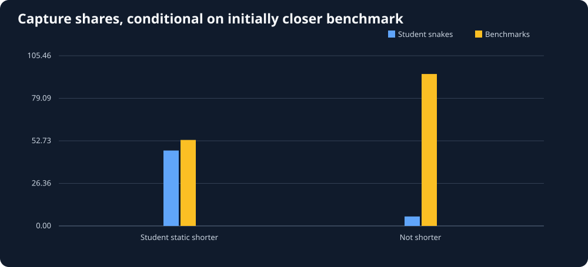

# Snake26: does occupied-space geometry explain underdog apples?

Generated UTC: 2026-11-01T23:46:10+00:00

## Critical definition

All included food episodes start with a built-in benchmark head at least THREE
toroidal Manhattan cells closer to the apple than the student head.
For this snapshot, temporarily treat ALL occupied snake body cells and
obstacles as permanently blocked, and run a toroidal breadth-first search
from each head to the food. This is an approximation: bodies and tails move.
Exclude episodes with no static path for either head, which can bias results.

## Main association

| Frozen-body path ordering | Student captures | Benchmark captures | Student capture share |
|---|---:|---:|---:|
| Student shortest | 193 | 205 | 48.5% |
| Benchmark shortest or tied | 151 | 2323 | 6.1% |

Observed difference in student capture share: **42.4 percentage points**.
Exploratory 95% **match-cluster bootstrap** interval for the difference:
**36.3 to 48.8 percentage points**
(4000 valid bootstrap draws, resampling 42 complete replay matches).
This interval reflects match-level resampling variability in this selected archive;
it does not adjust for bot version, different opponent skill or hidden strategy choices.

## Check whether the pattern is unique to one benchmark

| Initially closest benchmark | Reversal: student captures / all | Not reversed: student captures / all |
|---|---:|---:|
| ~benchmark | 57/112 (50.9%) | 21/762 (2.8%) |
| ~gauntlet_1 | 23/48 (47.9%) | 10/232 (4.3%) |
| ~hungry | 18/35 (51.4%) | 8/251 (3.2%) |
| ~hunter | 25/50 (50.0%) | 6/277 (2.2%) |
| ~survivor | 53/112 (47.3%) | 32/602 (5.3%) |
| ~wander | 17/41 (41.5%) | 74/350 (21.1%) |

## What this does and DOES NOT establish

- This is **predictive association in recorded states**, not causal proof.
- The more distant student may also differ in length, steering policy or risk tolerance.
- The static route freezes every snake body; real tails vacate and opponents move.
- A food capture is not necessarily a deliberate race by all possible opponents.
- All apple events within one replay are correlated and should be clustered.
- To claim a strategy advantage, validate these conditional patterns on held-out
  replays and later compare actual executable snakes under controlled seeds.
- No competition snake has been modified.
