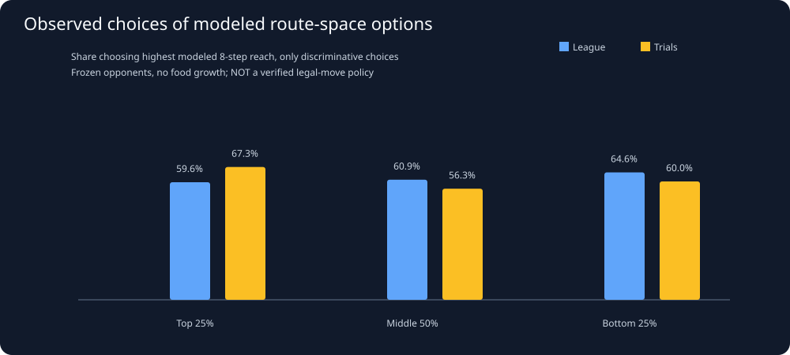

# Snake26: Do strong snakes choose routes with more future space?

Generated UTC: 2026-11-02T08:40:27+00:00

## Research question

Across ALL student snakes, does the ACTUAL first move after a
dangerous position preserve a larger possible future escape region?
Does modeled future space predict recorded deaths more usefully than
simply counting today's unoccupied neighboring cells?

## What the model DOES and DOES NOT simulate

For each sampled alive snake: enumerate possible next head positions
under a simplified no-growth, stationary-opponent projection.
Freeze OTHER snake bodies/obstacles. Compare:
1. **Frozen-body flood fill:** after each candidate first step,
   count connected currently-unoccupied cells (all bodies frozen).
2. **Tail-aware 8-step beam:** shift the OWN body one cell after
   every projected step, allowing tail cells to vacate (including
   legitimate repeated terminal coordinates during prior growth).
   Keep at most   64 distinct body states per depth with at most two states per head.
   Count distinct projected head positions reached over eight steps.
   Deterministic beam pruning means the count is approximate.
**Neither metric predicts opponent actions or food consumption/growth.**
Both are diagnostic geometry proxies, NOT engine-verified legal
routes, safe next moves, or alternative realities. The 8-step beam
counts positions across hypothetical paths, not a single escape route.
An actual apple could prevent the modeled tail from vacating.
The rank of the ACTUAL recorded first move is measured ONLY when
that snake has a valid recorded head on the NEXT frame. Missing
or dead-next-turn moves are excluded from choice comparisons.
Real death outcomes (next 10 turns) remain separate recorded labels.

## Coverage and validation of ordinary body shifts

Source danger-window observations: **2,637**.
Unique replay payloads WITH danger observations: **112**
(league 59, trials 53).
Audited dangerous windows: **2,637**
(league 2196, trial 441).
Observed first movements in model alternatives: league **2098**, trials **434**.
First moves missing because of death/absence: **8**.
Observed valid heads outside the simplified model: **97** (NOT silently made legal).
Recognized duplicated terminal tail cells during growth: **226**.
Invalid scene/body shape: **0**.
Missing frame/student: **0**.
Invalid source windows: **0**.
SHA mismatch / unreadable replay: **0**.
Any skipped rows remain excluded rather than silently designated safe.
Plain no-food-growth actual body transitions consistent with shift: **2587/2587**.
Modeled windows with no next candidates: **24**.

## 1. Choices of high predicted future space by actual league/trial bots

| Mode | Official Division 1 cohort | Students | Replays | Dangerous frames | Actual moves | Informative route comparisons | Choose max tail-reach | Choose max frozen flood-fill |
|---|---|---:|---:|---:|---:|---:|---|---|
| league | top_quartile | 13 | 37 | 486 | 465 | 310 | 60.97% | 53.06% |
| league | middle_half | 29 | 42 | 807 | 763 | 486 | 61.52% | 67.19% |
| league | bottom_quartile | 20 | 32 | 370 | 352 | 228 | 61.84% | 73.33% |
| league | unranked | 48 | 16 | 533 | 518 | 343 | 63.27% | 78.79% |
| trial | top_quartile | 5 | 12 | 81 | 81 | 55 | 70.91% | 0.00% |
| trial | middle_half | 4 | 8 | 78 | 74 | 52 | 61.54% | 40.00% |
| trial | bottom_quartile | 1 | 1 | 8 | 8 | 5 | 60.00% | insufficient |
| trial | unranked | 13 | 32 | 274 | 271 | 209 | 65.55% | 63.64% |

A candidate is **informative** only if alternative first moves have
different modeled scores; all-tie cases cannot demonstrate a
policy preference. Choosing the maximal modeled option is NOT proof
that that action was strategically optimal.

## 2. Can baseline route features predict actual +10 death?

ROC AUC measures how often a dangerous observation is ranked above a
non-death by its negative mobility score. 0.5 is chance, 1 perfect.
These are FIXED univariate features (no fit on this archive),
shown both overall and in a deterministic whole-replay hash holdout
(SHA prefix modulo 5 = 0). Because feature ideas were devised using
earlier archive results, this holdout is only a preliminary audit.

| Environment | Predictor (lower mobility => more risk) | All archive AUC | Fixed replay-holdout AUC | Holdout windows | Holdout death events |
|---|---|---:|---:|---:|---:|
| league | Current unoccupied neighbors | 0.68 | 0.73 | 760 | 23 |
| league | Best frozen-body flood-fill | 0.82 | 0.83 | 760 | 23 |
| league | Best no-growth moving-tail beam reach | 0.84 | 0.86 | 760 | 23 |
| trial | Current unoccupied neighbors | 0.88 | insufficient | 106 | 0 |
| trial | Best frozen-body flood-fill | 0.99 | insufficient | 106 | 0 |
| trial | Best no-growth moving-tail beam reach | 0.98 | insufficient | 106 | 0 |

## 2a. Whole-game bootstrap: how reliable is the holdout difference?

Use exactly the SAME held-out dangerous league frames for both
predictors. Repeatedly sample entire replay games, preserving
within-match correlation instead of resampling individual turns.
Intervals are exploratory and do not control for repeated bot versions
or feature engineering influenced by this historical archive.

| Holdout league contrast | Observed AUC advantage | Replay-bootstrap 95% interval | Games |
|---|---:|---|---:|
| Moving-tail reach minus frozen flood-fill | 0.037 | [-0.018, +0.106] | 19 |
| Moving-tail reach minus free neighbors | 0.131 | [+0.059, +0.220] | 19 |
| Frozen flood-fill minus free neighbors | 0.094 | [+0.029, +0.161] | 19 |

A confidence interval crossing ZERO means the data do not establish
that a more complicated feature is actually superior.

## 2b. Sensitivity to current body length

Length can change the meaning of 'room to move'; report all bins
rather than assuming one universally useful mobility estimator.

| League body length | Observed danger windows | 10-turn deaths | Free neighbors AUC | Frozen flood-fill AUC | Moving-tail reach AUC |
|---|---:|---:|---:|---:|---:|
| 5-24 | 372 | 7 | 0.62 | 0.67 | 0.65 |
| 25-49 | 372 | 13 | 0.58 | 0.85 | 0.81 |
| 50-99 | 796 | 24 | 0.72 | 0.86 | 0.89 |
| 100+ | 656 | 19 | 0.72 | 0.82 | 0.88 |

Small snakes and long snakes can differ; individual bins have few
death events, so these figures are NOT verified optimal thresholds.

Univariate AUC is NOT a calibrated hazard model. Match/body length
food density, opponent strength and available routes affect every
candidate feature. A test with no deaths cannot produce an AUC.

## 3. Same real game and baseline-matched strong/struggling choices

Use prior non-reused top-versus-bottom matched decisions, selected by
same replay, length band, head closeness, confinement and game phase.
Matched SAME-GAME pairs with route profiles: **66**.
Differences below are **bottom minus top**, where higher choice
rank means a modeled option preserved more projected future space.
Resampling full replay clusters gives exploratory intervals.

| Recorded decision measure | Both sides observed | Unique replay clusters | Bottom minus top | Replay bootstrap 95% interval |
|---|---:|---:|---:|---:|
| Tail-aware modeled choice percentile | 62 | 20 | 0.023 | [-0.023, +0.072] |
| Frozen flood-fill choice percentile | 62 | 20 | -0.016 | [-0.041, +0.004] |
| Chose highest modeled tail space | 39 | 18 | 0.000 | [-0.167, +0.200] |
| Chose highest frozen area | 0 | 0 | insufficient | insufficient independent matches |

Pairs remain nonidentical board states, even inside one game;
differences are descriptive only. In particular, moving opponents,
contest mechanics, and growth can reverse the apparent route order.

## 4. Candidate algorithm-design implication

A future route evaluator should examine *dynamic space and tail timing*,
not just the instantaneous four-neighbor count, IF these features
demonstrate useful out-of-match predictive value and controlled
league-like policy gains. These metrics remain observational and
simplified, so no weight or threshold has been justified.
Next: incorporate modelled opponent one-step reachable head cells
and verified engine growth/collision order, then compare more
accurate route risks on fresh league replay and controlled agent tests.

## Source data and reproducibility

- [Danger positions with actual observed route choices](../derived/route_choice_windows.csv).
- [All-student league/trial cohort summaries](../derived/route_choice_cohorts.csv).
- [Field-wide strong-vs-weak matched cohorts](competitive_cohorts.md).
- [Evidence-gated new algorithm rulebook](algorithm_rulebook.md).

**No submitted or new competition snake implemented.**
