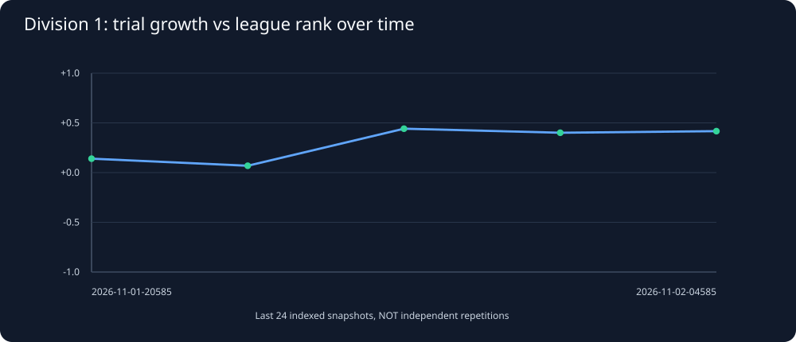
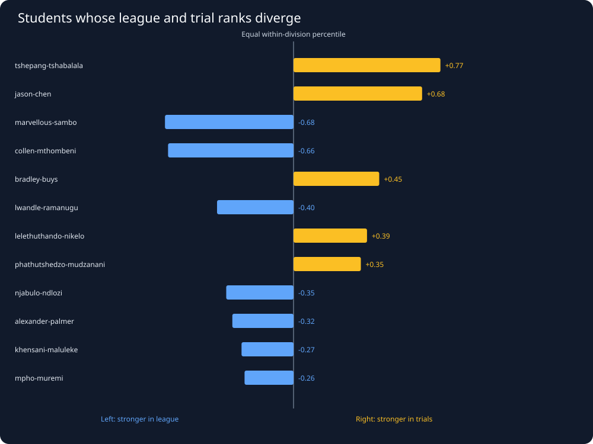

# Snake26: historical league versus trial specialization

Generated UTC: 2026-11-02T16:20:26+00:00

## Design and guardrails

League ranks are official division-specific rankings; we rerank students
inside the SAME eligible division cohort by their average final length
across the three fixed on-arrival trials. Official positions are separately
reranked within this eligible cohort before computing percentile gaps.
We require at least three cataloged peer league
games, all three on-arrival trials, and at least 10 students per division.
A normalized rank difference of +1 means excellent trials relative to
league, and -1 means excellent league performance relative to trials.
These are ranks, NOT inferred policy scores or match-level causal effects.

Current season: **2026-11-02-145901-season**.
Eligible historical Division 1 standings snapshots: **6**.
Positive league/trial rank correlation: **6** snapshots.
Median Division 1 correlation: **+0.378**.

Hourly seasons, repeated seeds, and unchanged bot versions are strongly
correlated. The history is a trajectory of recorded competition snapshots,
**not** a set of independent randomized experiments.

## 1. How does correlation evolve across seasons?

| Season | Division 1 students | Spearman rho: league rank vs trial growth rank |
|---|---:|---:|
| 2026-11-02-145901-season | 32 | +0.354 |
| 2026-11-02-045859-season | 32 | +0.417 |
| 2026-11-01-235859-season | 32 | +0.401 |
| 2026-11-01-225859-season | 32 | +0.442 |
| 2026-11-01-215859-season | 32 | +0.069 |
| 2026-11-01-205859-season | 32 | +0.140 |

## 2. Who specializes in a DIFFERENT environment?

**Positive difference:** relatively stronger three-trial growth;
**negative:** relatively stronger competitive league rank.

| Trial specialists (Division 1) | League rank | Trial rank within Division 1 | Gap | League games | League full replays |
|---|---:|---:|---:|---:|---:|
| 413538-lelethuthando-nikelo | 25 | 3.0 | +0.71 | 5 | 1 |
| 403339-david-ndambo | 26 | 8.0 | +0.58 | 5 | 0 |
| 419636-jason-chen | 16 | 4.0 | +0.39 | 5 | 0 |
| 419342-ayeshan-puckree | 29 | 18.0 | +0.35 | 5 | 0 |
| 388060-tshepang-tshabalala | 12 | 2.0 | +0.32 | 4 | 0 |
| 423436-ntobeko-zondi | 28 | 19.0 | +0.29 | 6 | 0 |
| 388828-ngcebo-methula | 18 | 10.0 | +0.26 | 5 | 2 |

| League specialists (Division 1) | League rank | Trial rank within Division 1 | Gap | League games | League full replays |
|---|---:|---:|---:|---:|---:|
| 404721-khensani-maluleke | 6 | 28.5 | -0.73 | 6 | 1 |
| 408070-collen-mthombeni | 9 | 30.5 | -0.69 | 4 | 0 |
| 428954-njabulo-ndlozi | 5 | 22.0 | -0.55 | 6 | 1 |
| 428786-marvellous-sambo | 13 | 25.0 | -0.39 | 4 | 0 |
| 421462-alexander-palmer | 3 | 14.0 | -0.35 | 4 | 0 |
| 424820-elisha-mundalamo | 1 | 12.0 | -0.35 | 5 | 4 |
| 406000-mulimisi-rammela | 14 | 23.5 | -0.31 | 5 | 0 |

## 3. Repeated snapshots and bot changes

The next table lists select current Division 1 extremes. SHA counts are
distinct *season-snapshot* version hashes, not confirmed per-match hashes.
Repeated identical snapshots can produce apparent consistency without
new independent evidence.

| Student | Eligible Division 1 snapshots | Distinct snapshot hashes | Median rank gap |
|---|---:|---:|---:|
| 413538-lelethuthando-nikelo | 6 | 1 | +0.29 |
| 403339-david-ndambo | 6 | 1 | +0.06 |
| 419636-jason-chen | 4 | 1 | +0.61 |
| 419342-ayeshan-puckree | 6 | 1 | +0.08 |
| 404721-khensani-maluleke | 6 | 1 | -0.44 |
| 408070-collen-mthombeni | 6 | 1 | -0.56 |
| 428954-njabulo-ndlozi | 6 | 1 | -0.28 |
| 428786-marvellous-sambo | 6 | 1 | -0.61 |

## 4. What this changes in our replay investigation

Target BOTH ends of the disagreement distribution: trial specialists
who underperform in league, and league specialists who struggle in trials.
For each, obtain actual full games from both environments and compare:
survival/respawn, contested-food decisions, opponent proximity, risk versus
growth and match outcomes under comparable conditions.
Use historical snapshots to select interesting students, NOT as
evidence of stable strategy unless versions and game conditions match.

## Export

[All historical matched student-season rank gaps](../derived/seasonal_rank_gaps.csv)

This is observational research; no competition snake has been modified.
