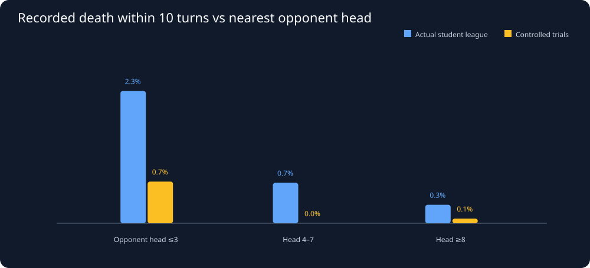

# Snake26: Head pressure, escape options, and subsequent deaths

Generated UTC: 2026-11-03T15:22:14+00:00

## Study design — actual replay frames, not a simulator

At every **25th turn**, for each living STUDENT, measure the toroidal
Manhattan distance to the nearest **living opponent head** and number
of immediately unoccupied neighboring cells (0–4, all current snake
bodies and obstacles treated as blocked). Check whether that same snake
has a recorded **death event in the NEXT 10 contiguous turns**.
A sampled window can include a death but we do not infer causes or intent.
The immediate-neighbor metric is a conservative **snapshot proxy**,
NOT a legal-action count or guaranteed future escape: tails and heads move.
Windows are spaced 25 turns apart to avoid overlapping 10-turn outcomes.
They are STILL correlated within snake and replay match.

## Coverage and quality first

- Archived files scanned: **240** of 240 candidate files.
- Unique replay payloads: **169**
(league **91**, trials **78**).
- Exact byte-identical duplicates skipped: **71**.
- Unreadable / invalid: **0**.
- Single-student league games excluded: **0**.
- Nonstandard trial rosters excluded: **0**.
- Student windows with complete follow-up: **35,039**.
- Distinct student/replay summaries: **442**.
- Latest sampled season: **2026-11-03-145900-season**.
- Latest sampled student-season with BOTH replay modes: **3**.

## 1. Head pressure and observed future death

| Environment | Nearest opponent head | Windows | Death in next 10 turns | Observed frequency | Unique replays |
|---|---|---:|---:|---:|---:|
| league | Opponent head ≤3 | 2,188 | 55 | 2.51% | 91 |
| league | Head 4–7 | 5,470 | 42 | 0.77% | 91 |
| league | Head ≥8 | 21,144 | 64 | 0.30% | 91 |
| trial | Opponent head ≤3 | 502 | 3 | 0.60% | 77 |
| trial | Head 4–7 | 1,241 | 1 | 0.08% | 78 |
| trial | Head ≥8 | 4,494 | 3 | 0.07% | 78 |

A close opponent head does NOT imply an aggressive attack or a collision.
This is a selected replay sample. Risk differences are not causal effects
and are not comparisons between equally skilled opponent populations.

## 2. Pressure vs distance alone: match-level uncertainty

- **league:** close-minus-far risk = **+2.21 percentage points**; exploratory 95% match-resampled interval **[+1.47, +2.95]**, 91 distinct replay clusters.
- **trial:** close-minus-far risk = **+0.53 percentage points**; exploratory 95% match-resampled interval **[-0.06, +1.21]**, 78 distinct replay clusters.

Resampling entire REPLAYS reduces pseudo-replication from repeated turns.
It does not adjust confounding from body length, opponent type, code
versions, player ability or game phase.

## 3. Compare danger within body-length categories

| Mode | Length | Head ≤3: death/windows | Head ≥8: death/windows | Close - far frequency |
|---|---|---:|---:|---:|
| league | 5-24 | 7/405 | 7/4646 | 1.58 pp |
| league | 25-49 | 16/418 | 10/4619 | 3.61 pp |
| league | 50-99 | 17/799 | 24/7036 | 1.79 pp |
| league | 100+ | 15/566 | 23/4843 | 2.18 pp |
| trial | 5-24 | 0/45 | 0/443 | 0.00 pp |
| trial | 25-49 | 1/82 | 0/487 | 1.22 pp |
| trial | 50-99 | 1/125 | 1/984 | 0.70 pp |
| trial | 100+ | 1/250 | 2/2580 | 0.32 pp |

## 4. Immediate escape space at the same head pressure

| Mode | Head proximity | Free neighboring cells | Death events/windows | Observed frequency |
|---|---|---|---:|---:|
| league | Opponent head ≤3 | 0-1 free sides | 18/184 | 9.78% |
| league | Opponent head ≤3 | 2-4 free sides | 37/2004 | 1.85% |
| league | Head ≥8 | 0-1 free sides | 38/934 | 4.07% |
| league | Head ≥8 | 2-4 free sides | 26/20210 | 0.13% |
| trial | Opponent head ≤3 | 0-1 free sides | 3/37 | 8.11% |
| trial | Opponent head ≤3 | 2-4 free sides | 0/465 | 0.00% |
| trial | Head ≥8 | 0-1 free sides | 1/121 | 0.83% |
| trial | Head ≥8 | 2-4 free sides | 2/4373 | 0.05% |

This helps distinguish crowded **local geometry** from opponent-head
pressure, but is still a snapshot association, not an actual 10-turn
pathfinding or safety proof.

## 5. Palmer and other known students — descriptive exposure only

| Student | Mode | Replay matches | Sampled windows | Head ≤3 share | 0–1 free-side share | Death in next 10-turn window |
|---|---|---:|---:|---:|---:|---:|
| 421462-alexander-palmer | league | 31 | 2478 | 8.4% | 4.4% | 4/2478 |
| 421462-alexander-palmer | trial | 3 | 240 | 7.5% | 2.5% | 0/240 |
| 388060-tshepang-tshabalala | league | 12 | 957 | 7.8% | 5.0% | 3/957 |
| 388060-tshepang-tshabalala | trial | 3 | 240 | 7.5% | 2.5% | 0/240 |
| 428786-marvellous-sambo | league | 10 | 798 | 8.3% | 4.5% | 8/798 |
| 428786-marvellous-sambo | trial | 1 | 80 | 12.5% | 1.2% | 0/80 |
| 409997-utayan-naidoo | league | 10 | 797 | 7.2% | 4.6% | 7/797 |
| 409997-utayan-naidoo | trial | 3 | 240 | 7.1% | 2.5% | 0/240 |
| 403754-vhuimo-mudau | league | 5 | 397 | 3.8% | 6.5% | 0/397 |

These students have very different recorded sample sizes. Rows include
multiple seasons and possibly changed bot submissions. Do NOT rank their
intrinsic skill using these unadjusted exposure percentages.

## 6. Same student and season: can head-pressure behavior transfer?

Latest sampled paired-student cohort: **3**.
At least four paired students with reliable coverage are needed even
to explore a rank correlation; sample size, opponent type and replay
selection must be shown before stronger conclusions.

## Reproducible exports

- [Student-season mode-separated threat exposure](../derived/threat_window_student_seasons.csv)
- [Per replay student exposure and outcome totals](../derived/threat_window_replay_summary.csv)

**Next hypothesis:** a strong competitor preserves local exits BEFORE
near-head encounters, rather than maximizing distance from everyone.
This study cannot yet establish that policy. Validate across new league
replays and matched controls before trying it in the Java agent.
