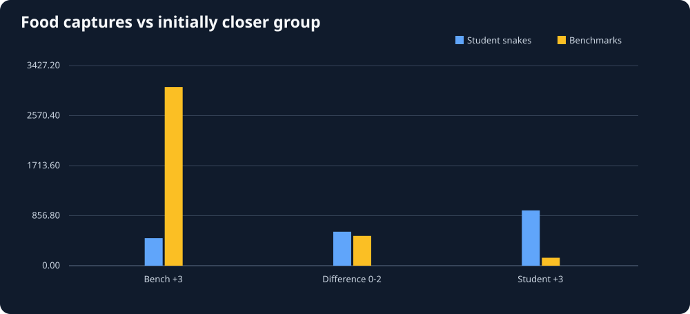
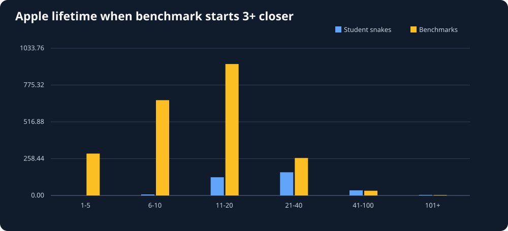
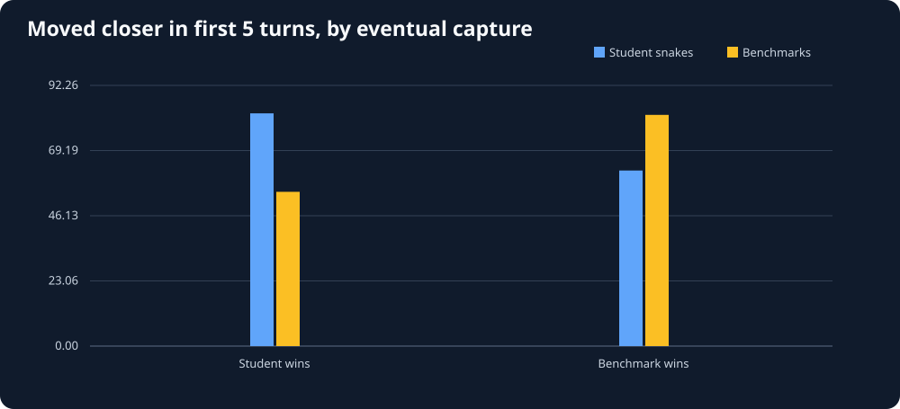
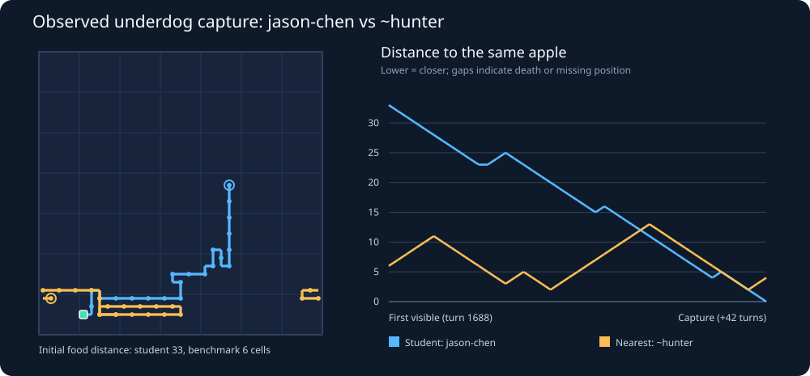
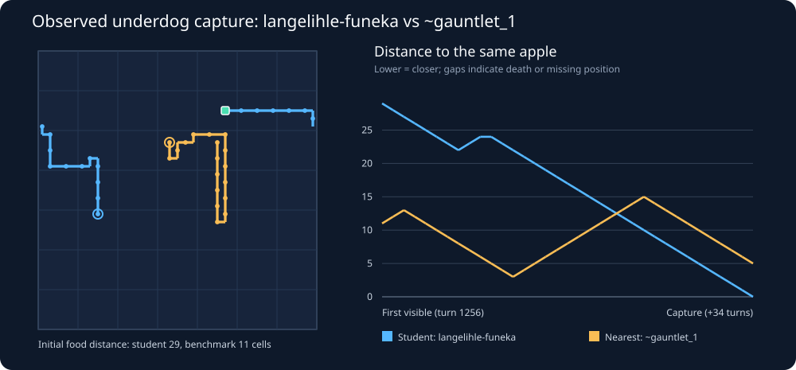

# Snake26 — How did the farther snake win?

Generated UTC: 2026-11-03T04:08:19+00:00

## Evidence quality

- Scanned **210** replay files; unique on-arrival trial replays: **66**.
- Duplicate archived trial files skipped: **13**; unreadable: **0**.
- Comparable first-visible student-vs-benchmark apple opportunities: **8131**.
- Captures matched to real next-frame head + eat event: **8063**.
- Disappearances without verified consumer: **4**.
Only on-arrival trials with EXACTLY one active student and at least one living built-in benchmark are included.
All distance comparisons use toroidal Manhattan geometry, not hypothetical safe paths.

## Initial distance disadvantage versus actual winner

| Who started at least 3 cells closer? | Student captured | Benchmark captured | Student share |
|---|---:|---:|---:|
| Benchmark | 676 | 4,315 | 13.5% |
| Neither (within 2) | 829 | 739 | 52.9% |
| Student | 1,298 | 206 | 86.3% |

The student share above describes captured apples only. One student faces three
benchmarks and their starting abilities and survival vary; it is NOT a fair head-to-head win rate.

## Focus: student captured while a benchmark started 3+ closer

- Verified captures: **676**; benchmark wins while initially closer: **4315**.
- In student wins, initially nearest benchmark died before capture: **111**.
- In student wins, student died before capture: **2**.
- In student wins, nearest benchmark consumed another apple before this capture: **0**.
- In student wins, benchmark had NO static path at first sight (all occupied bodies frozen): **124**.
- In student wins, student had no static path under the same approximation: **47**.
- In student wins, both static paths existed: **546**.
- Of those, the student's static path was SHORTER despite longer Manhattan distance: **307**.
- Median apple lifetime, student wins: **23.0 turns**; benchmark wins: **12 turns**.

## First five turns: movement toward apple

- Complete comparable five-turn, death-free trajectories: **563** student-win
  and **3753** benchmark-win apple episodes.
- Student-win: student progress **3.06** cells on average; nearest
  benchmark progress **0.57** cells (distance decrease positive).
- Benchmark-win: student progress **1.26** cells; nearest
  benchmark progress **3.12** cells.
We exclude episodes with a death or respawn of either focal snake anywhere before capture
from this particular five-turn comparison. The selection is intentional but may bias results.
The apple must remain visible for 5 turns; fast captures are also excluded.

## Individual cases for inspection

See **underdog_examples.json** for up to 15 recorded distance traces of student wins
where a benchmark started at least 3 cells closer, both focal snakes remained alive,
and the apple remained present at least 8 turns.
See **underdog_episodes.csv** for all matched on-arrival events with distances, capture
time, death flags, and early-distance progress.

| Replay | First visible turn | Student initial distance | Nearest benchmark | Benchmark distance | Captured after |
|---|---:|---:|---|---:|---:|
| 2026-11-01-215859-season/trials/419636-jason-chen/trial-911000.rep | 1688 | 33 | ~hunter | 6 | 42 |
| 2026-11-01-215859-season/trials/419636-jason-chen/trial-911000.rep | 989 | 27 | ~wander | 2 | 56 |
| 2026-11-02-225901-season/trials/408008-bradley-buys/trial-911000.rep | 1821 | 29 | ~wander | 5 | 57 |
| 2026-11-02-045859-season/trials/423158-risima-mashele/trial-912000.rep | 1542 | 27 | ~benchmark | 4 | 45 |
| 2026-11-02-225901-season/trials/406000-mulimisi-rammela/trial-910000.rep | 1382 | 32 | ~survivor | 10 | 32 |
| 2026-11-01-225859-season/trials/419926-mphile-nchabeleng/trial-910000.rep | 1290 | 28 | ~survivor | 7 | 67 |
| 2026-11-01-225859-season/trials/413538-lelethuthando-nikelo/trial-911000.rep | 663 | 24 | ~hunter | 4 | 24 |
| 2026-10-14-123340-season/trials/409997-utayan-naidoo/trial-910000.rep | 516 | 31 | ~survivor | 11 | 34 |
| 2026-10-24-035858-season/trials/402334-angile-saho/trial-912000.rep | 1256 | 31 | ~gauntlet_1 | 11 | 42 |
| 2026-11-03-025900-season/trials/427064-khodani-netili/trial-911000.rep | 1815 | 28 | ~wander | 8 | 68 |

## Interpretation and next work

Farther-but-faster does not automatically imply pathfinding superiority.
A closer snake could have chosen a different apple, waited for safety, or been
unable to reach the apple along a safe path. Other opponents can affect both.
Next: calculate **actual route efficiency and obstacle-aware distance at first sight**;
compare traced examples, then produce spatial board/path visualizations.
Static path is a conservative snapshot BFS with all snake bodies frozen in place;
tails can vacate, so an unreachable static path does NOT mean a truly impossible route.
A benchmark eating another apple is observed diversion, not proof of its objective.
No competition bot has been modified.

## Observed spatial paths and distance histories

Paths follow actual recorded heads; wraparound edges are not drawn as teleports.
